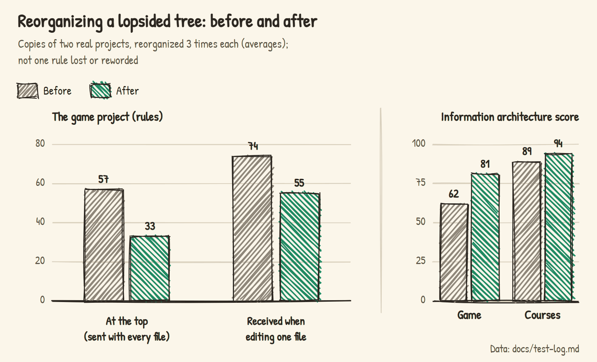
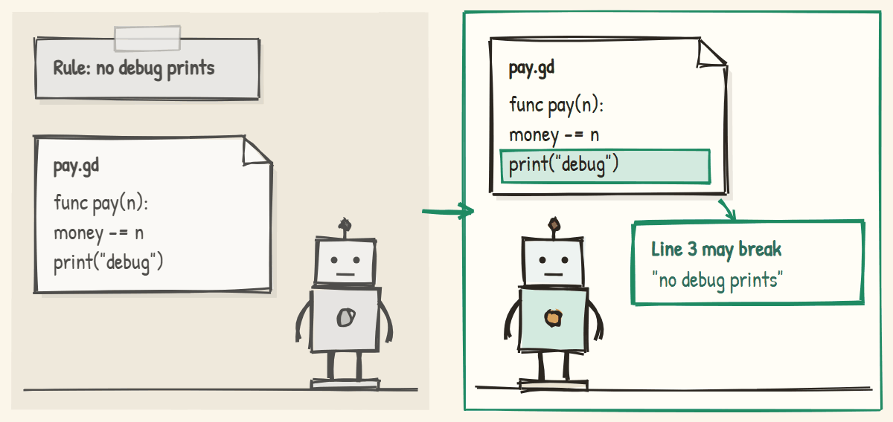
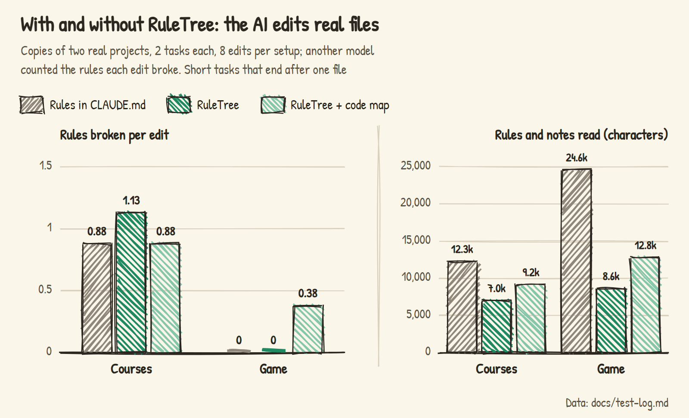

# RuleTree

A well-designed information architecture for AI coding: rules, docs and code maps each in their place, kept tidy for you, and the AI reads only the rules for the file it's editing.

A VS Code extension for [Claude Code](https://claude.com/claude-code) and [OpenAI Codex](https://developers.openai.com/codex). English | [中文](README.md)


The lasting requirements you state in chat are recorded after each turn by a small background model (Haiku) into a file in your project, `需求树.md` (the tree), under the requirement that covers the files they concern. The tree is compiled into Claude Code's own path-scoped rules: whichever file the AI reads or writes, Claude Code hands it the rules covering that file, in a new conversation, after compaction, and inside sub-agents alike. As rules pile up, one click on "Check-up" merges duplicates, settles contradictions, regroups the structure and scores the information architecture.


## Sound familiar?

1. The same rule lives in chat, CLAUDE.md, the AI's memory and a module's doc, and later only one copy gets updated. One of the author's projects had 237 duplicates, contradictions and stale rules across 21 rule documents.
2. Rules keep piling up while the structure stays the way it started. In the author's game, one requirement held 41 rules, so editing a streetlight script also brought rules about shop furniture.
3. CLAUDE.md and design docs run to tens of thousands of words, and the AI reads them top to bottom to change a comma.
4. A requirement you gave while working on payments gets applied to other modules; start a new conversation and it's gone.
5. The rule is written down and the AI still breaks it, and you can't tell whether any of this works.


## Everything in its place

| Where | What | When the AI reads it |
|---|---|---|
| Rules (in the tree) | A requirement you can follow from one sentence, like "amounts are always integer cents" | Delivered automatically when the matching files are touched |
| Decisions (rules starting with "Decision:") | The option you chose, with the reason | Same; the AI must ask you before overturning one |
| Docs (attached to requirements) | What a rule can't hold: why, how, examples, progress | When the matching files are touched, contents first, then only the sections needed |
| Code map (generated) | The files, functions and classes already in this part of the code | When the AI wants to know before writing something new |
| The AI's auto memory | Things unrelated to the project, like your machine | Managed by Claude Code |
| CLAUDE.md | The front door: what the project is, where things are | Every time, so the shorter the better |

Each thing is written in one place: what you can follow goes in the tree, what needs explaining goes in a doc. Every requirement says which files it covers, so editing a file brings only the rules on the path from the whole project down to that file.


## The architecture keeps itself tidy

Information keeps arriving, so fixed places aren't enough. RuleTree maintains the structure itself: new rules are filed by the files they govern, rules written in docs and the AI's memory move into the tree, duplicates are merged, contradictions settled (the later statement wins), stale rules cleared out. When a requirement carries too many rules or too many sit at the top, the AI regroups the requirements and hangs every rule, word for word, back at the level that covers its files. Reorganizing copies of the author's two projects 3 times each lost no rule and changed no wording:



## The interface

| Sidebar (dark theme) | Map (light theme) |
|---|---|
|  |  |

| The requirement the AI is editing lights up | Which rules this conversation read, and how long each is |
|---|---|
|  |  |

## Installing

You need Node.js 18 or later, VS Code, and Claude Code or OpenAI Codex. The easiest way is to open a Claude Code or Codex conversation in your project and send it this:

```text
Install RuleTree (https://github.com/penstic123-code/Vibe-Friend) in this project:
1. Run npx github:penstic123-code/Vibe-Friend init . (if you are Codex, add --tool codex at the end)
2. Download the latest reqtree-*.vsix from https://github.com/penstic123-code/Vibe-Friend/releases/latest, put it outside the project folder, and tell me where
3. Don't run code --install-extension yourself; tell me how to install it from VSIX in VS Code
```

Install the extension yourself: VS Code's Extensions panel → `…` → "Install from VSIX". Installing from the command line restarts the running AI conversation along with it. Then open your project and click "Enable"; the AI reads the project and builds the first tree in a minute or two, and a new conversation picks it up. Every change can be undone in one click under "Recent changes". For Codex, see [docs/codex.md](docs/codex.md).

## How it works

### Rules arrive by the file being edited

The AI only sees its context, so a new conversation, compaction or a sub-agent loses what was said earlier; putting every rule in CLAUDE.md means reading all of them whatever you edit. RuleTree keeps the rules in files and delivers them by file:


```markdown
# P Town game
- Comments in English                 ← applies whatever you edit

## R3 Shops
> files: game/shops/**                ← the files this requirement covers
> docs: docs/shop-design.md           ← read before editing here
- Staff stay inside the shop

### R3.1 Doors and opening hours
> files: game/shops/shop_door.gd
- Opening hours only come from ShopHours
```

Editing `shop_door.gd`, the AI gets three layers: the project's, the shops', the doors'; nothing from other modules. A lower level can replace one of the upper level's rules, within its own scope:


In a project with six web courses, filing the rules in the tree cut what the AI reads for one chapter by 30–50%:


### Long docs: contents only

A long doc attached to a requirement isn't sent whole; the AI gets one line saying what the doc covers, how long it is, and where each section starts and ends. It reads the contents and then only the lines it needs. You can also attach a single section, like `> docs: docs/shop-design.md#Opening hours`.

### Recorded in the background, edited in place

After each turn, the recorder reads the conversation and decides what is meant to last. When you change your mind it rewrites the old rule instead of adding a new one; when unsure how wide a rule reaches, it files it under the requirement you're working on. Every change is logged in "Recent changes", one click from undo.


### Check-ups: duplicates, contradictions, stale rules and structure

On "Check-up", the program first gathers evidence: which rules arrive together on the same file, which files or class names they mention no longer exist, which requirements carry too much. The model only judges those candidates: duplicate, contradiction or deliberate exception, really stale or not. It weighs which requirements are in progress and when you set each rule; the later decision wins. What it's sure about it changes; what it isn't, it leaves; it asks only before overturning one of your Decisions.

### Checked right after the edit

The AI slips even with the rule in front of it. During a check-up, the model picks out rules whose violations show on a single line (no debug prints, don't use a certain phrase) and writes a check for each; whenever the AI finishes editing a file, the lines it just wrote are checked, and the AI is told about likely slips.



### A score for the information architecture

Every check-up report ends with a score you can compare over time. The author's game project after reorganizing (generated in Chinese, translated):

```text
Score 82 (reach 100 · size 79 · lean root 48 · context 70 · no overlap 99 · code placement 98)
Structure: 47 requirements, 2 levels deep, 332 rules; 31 at the root (sent with every file); 8 requirements carry 12+ rules of their own
Sent when editing one file: 49.4 rules, 7,611 characters on average
Last 30 days: the recorder added 24 rules; you undid it 0 times and edited or deleted 1 of its rules
```

The six parts: rules that never reach the AI, requirements carrying too much, rules piled at the top, characters received per file, requirements that overlap, code filed in the wrong place.

## Test data

All experiments ran with real models on copies of the author's two real projects: a Godot game and a project with six web courses.

### With RuleTree, does the AI read less and follow rules better?

The AI made real edits: a summary or an exercise for course chapters, an opening-hours hint or delivery tips for the game. With the same rules, one setup had them all in CLAUDE.md, one had RuleTree, one had RuleTree plus the code map; 16 edits each, and another model counted the rules each edit broke.



The AI read 40–60% less, but broke no fewer rules: about one per edit on the courses for every setup, close to none on the game. These were short tasks ending after one file; long conversations haven't been tested. Sending the full code map showed no benefit, so the AI now reads it only when it wants to.

### Are rules from real conversations recorded right?

The messages the author typed in 12 conversations over a few weeks were replayed in order through the recorder, and another model scored the result against "the rules that should be in force now". The earlier version often filed a general request made while working on one course under that course; the recorder now files rules by the files they govern:


Misfiling is mostly fixed, but more rules are missed; that's next.

### Compared with letting the AI keep its own rules doc?

A simulated 32-turn conversation: the user makes 13 lasting requests, changing their mind, cancelling some, adding exceptions. Keeping its own notes, the AI often answers "drop the reflection questions" by adding "no reflection questions" while the old rule stays; RuleTree deletes the cancelled rule.


### Does reorganizing lose or change rules?

Three reorganizations per project lost no rule, changed no wording and dropped no Decision. Of three problems planted in the copies, a code-only rule at the top was moved under "Code conventions" and turned into a check (6 of 6), and a rule telling the AI to use a class that doesn't exist was removed as stale (8 of 8). Two contradicting docs were caught every time in the course project, which has few docs, and never in the game project, which has many; the comparison has been changed since and not yet retested.

Raw data and details of each experiment are in [docs/test-log.md](docs/test-log.md) (in Chinese).

## Compared with other approaches

| Approach | Does | Doesn't |
|---|---|---|
| All rules in CLAUDE.md | Read at the start of every conversation | Read in full whatever you edit; grows long; you maintain it |
| The AI's auto memory | Writes some things down automatically | Doesn't know which module a rule belongs to; gets messy |
| Your own rule docs | As detailed as you like | You keep them current; the AI doesn't know which to read when |
| [graphify](https://github.com/safishamsi/graphify), [aider's repo map](https://aider.chat/docs/repomap.html) | Help the AI understand code, better than RuleTree's code map | Ignore your requirements and rules; no GDScript |
| RuleTree | Records requirements, sorts them by module, delivers by file; tidies and scores itself | The recorder misses or misfiles some rules; not yet shown to make the AI follow rules better |

## FAQ

<details>
<summary>Doesn't the AI already remember what I said?</summary>

Within one conversation, yes. After a new conversation, compaction or in a sub-agent, it can't see it. RuleTree keeps rules in files and puts them in front of the AI when they apply.
</details>

<details>
<summary>With thousands of files, how does the AI know which rule is where?</summary>

It doesn't have to look. Rules are compiled into Claude Code's own "load by path": whichever file the AI reads or writes, Claude Code hands it the rules for that file.
</details>

<details>
<summary>Is it slow? Will it keep asking me things?</summary>

The recorder runs once per turn in the background, about 6 seconds; a check-up on a big project takes a few minutes. When unsure, it records the most likely reading or changes nothing; it asks only when what you said would overturn one of your Decisions.
</details>

<details>
<summary>With RuleTree, will the AI follow rules better?</summary>

Not measurably yet. What's clear is that it reads 40–60% less and rules no longer disagree across places. That's why the check-after-edit exists.
</details>

## Limits

- Not yet shown to make the AI follow rules better.
- Rules arrive by file; a project that keeps everything in one file can't get only part of them.
- The recorder relies on a small model; replaying real conversations, about one rule in five was missed and about 5% recorded wrong, for you to fix or undo.
- Contradicting docs are only caught within one part of the project.
- The code map reads code with regular expressions; unusual languages may be read incompletely.
- Codex has no rules-by-file mechanism, so it uses an index plus delivery on demand.
- Developed on Windows; Mac and Linux are covered by automated tests.

## For developers

Design notes in [docs/architecture.md](docs/architecture.md) and [docs/design-info-architecture.md](docs/design-info-architecture.md) (in Chinese).

```bash
node --test test/*.test.js             # all automated tests
node bin/reqtree.js                    # command-line usage
node bin/reqtree.js health 需求树.md   # score a tree
```

Image sources are in `docs/images/src/`. Don't force-reinstall the extension from the command line while using Claude Code; it restarts Claude Code too.

## License

MIT
