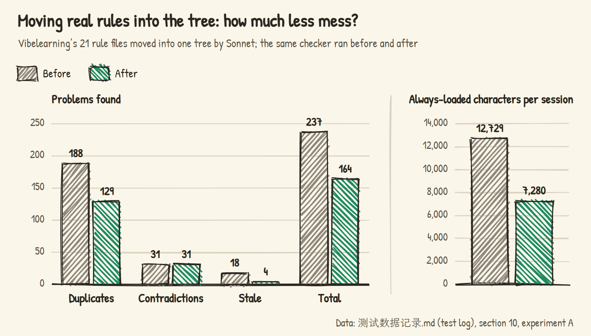

# Vibe Friend · ReqTree

If you build things with an AI assistant, you've probably typed "didn't we already agree on this?" more times than you'd like. ReqTree is for that moment. It keeps the requirements and rules you set in chat in one tree. When the AI edits a file, it hands over just the rules for that part; when you mention a long-term preference in passing, a background recorder writes it down, and if it gets it wrong, one click undoes it.

For [Claude Code](https://claude.com/claude-code) and [OpenAI Codex](https://developers.openai.com/codex), with a VS Code extension. **English** | [中文](README.md)


Say "from now on, end every chapter with one thinking question" in chat. When the turn ends, it's in the tree. Wrong place? Click undo.

## Sound familiar?

You work with an AI assistant on a long project. A few weeks in, the same rule has grown a few copies of itself: said once in chat, written once in CLAUDE.md, stored once in the assistant's memory, copied again into a project doc. Then you change your mind, update one of them, and the other three keep insisting on the old version.

Requirements drift the same way. A feature gets revised again and again; the plan from three weeks ago has been overturned twice. Eventually even you can't say what the project currently looks like: which requirements are done, which are in progress, which version of a rule is the latest.

The assistant isn't having a great time either. The conversation gets long, the context gets compacted, and the "paragraphs at most 4 lines" rule you agreed on early is gone. A subagent gets half the rules. Ask "what did we decide?" and it picks one of three documents that disagree with each other.


I audited my own course project after a few months of work: 21 rule documents, over 80,000 characters, 237 duplicated, contradictory or outdated rules. One document said "run only one agent at a time", another said "two or three chapters can run in parallel"; the same "three checks" rule had been copied 15 times.

## What it does

<table>
<tr>
<td width="50%" valign="top"><br><sub>Problem</sub><br>Requirements changed so often — what does the project look like now?<br><sub>ReqTree</sub><br>One tree shows it all: how far each part is, which rules are current; changes by the recorder and from the panel are logged and undoable</td>
<td width="50%" valign="top"><br><sub>Problem</sub><br>The same rule lives in four places. Which one counts?<br><sub>ReqTree</sub><br>Every rule lives in one file, in exactly one place</td>
</tr>
<tr>
<td width="50%" valign="top"><br><sub>Problem</sub><br>The same rule gets added again and again<br><sub>ReqTree</sub><br>The recorder rewrites the original instead of adding; undo in one click</td>
<td width="50%" valign="top"><br><sub>Problem</sub><br>Long chats and compaction make the AI forget the rules<br><sub>ReqTree</sub><br>Rules use Claude Code's native mechanism and survive compaction and subagents</td>
</tr>
<tr>
<td width="50%" valign="top"><br><sub>Problem</sub><br>Every rule gets stuffed into the context<br><sub>ReqTree</sub><br>Only the rules for the file being edited come along</td>
<td width="50%" valign="top"><br><sub>Problem</sub><br>Parent and child rules contradict each other<br><sub>ReqTree</sub><br>A child requirement overrides its parent, only within its own scope</td>
</tr>
<tr>
<td width="50%" valign="top"><br><sub>Problem</sub><br>What is the AI working on right now?<br><sub>ReqTree</sub><br>The sidebar and map show it live</td>
<td width="50%" valign="top"><br><sub>Problem</sub><br>Hand-editing Markdown<br><sub>ReqTree</sub><br>Add rules, change status, undo — all by clicking</td>
</tr>
</table>

## The interface

| Sidebar (dark theme) | Mind map (light theme): select a requirement and the other branches fade |
|---|---|
|  |  |

| Focus: only this branch | Context meter: which rules this session loaded, and how big each is |
|---|---|
|  |  |

The UI follows VS Code's display language (English or Chinese).

## Installing

**You need** Node.js 18+, VS Code, and Claude Code or OpenAI Codex.

### Let the AI install it

Open a Claude Code or Codex session in your project and send it this:

```text
Please set up ReqTree (https://github.com/penstic123-code/Vibe-Friend) in this project:
1. Run npx github:penstic123-code/Vibe-Friend init .  (if you are Codex, add --tool codex at the end)
2. Download the latest reqtree-*.vsix from https://github.com/penstic123-code/Vibe-Friend/releases/latest to a folder outside this project and tell me where it is
3. Don't run code --install-extension yourself; tell me how to install it in VS Code from the VSIX
```

After step 1 the project has its hooks and a template `需求树.md`. The extension is left for you to click, because installing it from the command line inside VS Code restarts the AI session that's running — mid-sentence. Once it's installed, start a new session and you're set.

### Install it yourself

1. Install the VS Code extension: download `reqtree-<version>.vsix` from [Releases](https://github.com/penstic123-code/Vibe-Friend/releases), then Extensions → `…` → "Install from VSIX".
2. Open your project. The extension asks whether to enable ReqTree here — click enable. (Or run "需求树：在本项目启用" from the command palette.)
3. Start a new Claude Code session and work as usual.

Rather skip the extension? The command line works too:

```bash
npx github:penstic123-code/Vibe-Friend init <your-project>               # Claude Code
npx github:penstic123-code/Vibe-Friend init <your-project> --tool codex # OpenAI Codex
```

Enabling installs hooks in the project (Claude Code: `.claude/settings.local.json`; Codex: `.codex/hooks.json` plus a managed block in `AGENTS.md`) and creates a template `需求树.md` if there is none. The hook scripts are copied to `~/.reqtree/runtime/` and refreshed when the extension updates. For Codex details see [docs/codex.md](docs/codex.md) (in Chinese).

## After that

Day to day you don't do anything extra:
- Say "from now on, end every chapter with a reflection question", and after that turn it appears in the tree.
- When the assistant edits `ch01.html`, it automatically gets the rules of Chapter 1 and everything above it; other courses' rules stay out of the way.
- The sidebar shows which requirement the assistant is editing. If the recorder got something wrong, click undo under "Recent changes".

### What the tree looks like

```markdown
# P Example course
- [para] Paragraphs at most 4 lines          ← root rules apply everywhere

## C2 Data science course 🔨
> 文件：DataScience/**                       ← the files this requirement covers
- No direct quotes; retell everything

### C2.1 Chapter 1 🔨
> 文件：DataScience/ch01-*.html
- [para] The opening may run to 6 lines      ← same key: overrides the parent in Chapter 1
- Hook the reader within the first screen
```

- A heading is a requirement: an ID first, a status last (✅ done 🔨 in progress ⏳ to do ❓ undecided).
- List items under a heading are its rules.
- A requirement without `> 文件：` (files) inherits its parent's scope; if no ancestor has one, the panel warns you.

## How it works

Everything revolves around one file. While you chat, a background recorder writes long-term requirements into `需求树.md`. The tree is compiled into one rule file per requirement, each declaring which files it covers. When the assistant touches matching files, Claude Code itself hands it those rules.


**Loading on demand.** Each requirement compiles to `.claude/rules/reqtree/<ID>.md` with a `paths:` header. These are Claude Code's native path-scoped rules: they enter the context only when the assistant reads or writes a matching file. A parent's scope contains its children's, so editing Chapter 1 brings in the root, the course and the chapter rules; the other courses' rules stay home.


**The recorder.** At the end of each turn, a hook wakes up Claude Haiku in the background. It receives the requirement tree and the last two turns (your message and the assistant's final reply in each); every 8 turns and before the context is compacted, it also gets up to 20 of your recent messages to see whether anything slipped through. All of this goes to the model provider you already use (Anthropic for Claude Code, OpenAI's codex exec for Codex). It first looks for a rule on the same topic: if there is one, it rewrites it; otherwise it adds one. One-off instructions ("shorten this paragraph") are not recorded, and short replies like "ok" or "continue" don't even wake the model. Changes apply immediately and are logged in `.reqtree/changes.jsonl` with an inverse operation, so each one can be undone.

**When it's unsure, it asks.** If a new statement is about the same thing as an existing rule, the recorder rewrites the old rule to match the latest wording, even if you never said "change it to". Some things only you can settle. Does "chapter 5 can have a few more interactions" make an exception for that chapter, or apply to every chapter from now on? Does "the journal style is only for part one" narrow the old rule or add a new one? Is a chapter finished? In cases like these the recorder writes down the most likely reading and shows a notification in VS Code with a few options. You can ignore it, and the first reading stays in effect; if you pick another option, the first change is undone and replaced with yours. Requirements marked in progress that haven't been touched for a few days get the same kind of question: is it done? Questions are kept in `.reqtree/questions.jsonl`; after seven days without an answer, the first reading stands. If it gets chatty, the `reqtree.askQuestions` setting can reduce this to a count on the sidebar icon, or turn the questions off.

**Check-up.** The "ReqTree: Check-up" command (`reqtree check --fix` on the command line) merges near-identical rules within one requirement, keeping the later one, then makes one Haiku call to find rules that disagree between a parent and a child without being written as an override, such as "at most 4 interactions per chapter" for the whole project and "at most 5" in one course. Each one becomes the same kind of multiple-choice question. The model is called only when you run the command.


**Why not inject rules with hooks?** Early versions did exactly that. Claude Code's native rules turned out to be more reliable: they work inside subagents and after compaction, and rules created or edited mid-session are pushed to the assistant. So rules are left to the native mechanism, and the hooks only do what it can't — track which requirement is being edited and wake the recorder. The one exception is discussion before any file is touched: when you ask "how should Chapter 3 work?", the assistant hasn't opened a file yet, so the hook adds the rules of the requirement you named, once per session.

| Part | What it does |
|---|---|
| `src/parser.js` | Parses the tree; every edit goes through `applyOps`, and each operation returns its inverse; similarity-based dedupe |
| `src/compile.js` | Compiles each requirement into a native rule file; inheritance via nested scopes, overrides written as "within this scope, this one wins" |
| `src/store.js` | Locked atomic writes, recompiles after every write, change log and undo, state files |
| `hooks/hook.js` | Keeps rules fresh when you send a message, records which requirement an edited file belongs to, starts the recorder at the end of a turn, and logs which rules were loaded |
| `hooks/recorder.js` | Uses Haiku to decide whether the turn contained a long-term requirement, then rewrites or adds a rule; unclear cases become questions |
| `src/questions.js`, `src/checkup.js` | Storing, answering and undoing questions; stale requirements; check-up |
| `extension.js`, `media/` | VS Code sidebar and mind map |

## Saving context and tokens

| Feature | Status |
|---|---|
| Rules load on demand: they enter the context when the AI reads or edits a matching file | ✅ |
| Hooks add rules only when you name a requirement whose files the assistant hasn't touched yet; otherwise nothing | ✅ |
| Old rules are rewritten instead of duplicated, so the tree doesn't keep growing | ✅ |
| The recorder uses the inexpensive Haiku model in the background; short replies skip it | ✅ |
| Context meter: which rules each session loaded, how many characters each, resident vs on demand | ✅ |
| Split CLAUDE.md: move requirement-specific content into the tree so it loads on demand | Planned |
| Cross-file duplicate and contradiction check between the tree, CLAUDE.md and project docs | Planned (experiment script exists) |

In practice, the AI reads 30–50% fewer characters of rules to work on one chapter of a course — see "How much better after moving them into a tree?" below.

## Test data

Each experiment below answers one question. Raw data and experiment conditions are in [`测试数据记录.md`](测试数据记录.md) (the test log, in Chinese).

### Does the recorder get things wrong or add duplicates?

The recorder mostly meets six situations: you restate an old rule in new words; you change your mind; you give a new rule; you ask for a one-off edit; you reject a rule; you repeat a parent's rule inside a child requirement. Two easily confused ones were added later: "open Chapter 1 with the cholera story" is a decision Chapter 1 should keep following, while "tighten that paragraph in Chapter 1" is done once it's done. Run five times each with the real Haiku model, the recorder handled every case correctly: no duplicates, changes of mind rewrite the original rule, one-off edits are not recorded.


### Compared with letting the AI maintain its own rule document?

A simulated 32-turn conversation: the user gradually states 13 long-term requirements, changes their mind, cancels some, adds exceptions. One arm lets the AI keep its own rule document; the other uses ReqTree. When the AI keeps the document, "drop the reflection questions" often becomes a new line "no reflection questions" while the old rule stays, and an exception like "only 3 exercises in Chapter 2" sometimes turns into a global rule. ReqTree deletes the cancelled rule and files the exception under Chapter 2. At first ReqTree also missed decisions about a single chapter's content; after the recorder's criteria were fixed, it captured almost all 13 requirements.


### How messy are real rule documents?

Back to that course project. Across its 21 rule documents the problems sit mostly across files: the same rule copied in several places, updated in one and stale in the others; one file says "run one agent at a time", another says "two or three chapters can run in parallel".


### How much better after moving them into a tree?

The rules from those 21 documents were moved into one requirement tree and audited again with the same checker. Duplicates and outdated rules dropped sharply, because each rule now has one place and old wording was replaced by the latest during the move. Contradictions did not drop: where a course rule conflicts with a global one, the original text never said "this course is an exception", so the move can't decide which one wins. That call is still yours, and now it comes to you as a question.



The context savings are easier to see. Before, every session carried CLAUDE.md and the memory, and working on a course meant reading that course's whole rule document. With the tree, only the global rules are always loaded; a course's rules arrive when its files are touched. To work on one chapter of any course, the AI reads 30–50% fewer characters of rules.


### Replaying real conversations

436 messages I actually typed across 12 sessions over several weeks were replayed in order. One arm let the AI record rules as it normally would, into CLAUDE.md, memory and course documents (seeing only some of them each time); the other used ReqTree. Both were checked against the same answer key.

ReqTree missed fewer requirements, kept fewer overturned rules, and ended with a rule base a third the size. Its extra errors were of one kind: general preferences mentioned while working on one course, such as "reply in Chinese", got filed under that course, so other courses didn't get them. The recorder's criteria have since been adjusted for this.


## Current limits

- Works with Claude Code and OpenAI Codex. Codex has no path-scoped rules, so ReqTree uses an index in `AGENTS.md` plus hooks that deliver the right rules (see docs/codex.md).
- The recorder relies on a small model and occasionally files a rule in the wrong place. When it notices it is unsure, it asks you; mistakes it doesn't notice are yours to fix in the panel, or to undo under "Recent changes".
- Each turn costs one extra Haiku call, run in the background (about 6 seconds).
- Developed on Windows; macOS and Linux are covered by CI.

## Command line

```bash
node bin/reqtree.js init    <project>          # enable: install hooks, compile rules
node bin/reqtree.js tree    需求树.md           # print the whole tree
node bin/reqtree.js rules   需求树.md C2.1      # the rules in effect for one requirement
node bin/reqtree.js compile 需求树.md           # compile by hand (normally automatic)
node bin/reqtree.js check   需求树.md           # duplicate IDs and rules, requirements without files, stale 🔨
node bin/reqtree.js check   需求树.md --fix     # check-up: merge duplicate rules, turn conflicts and stale 🔨 into questions (--no-model skips the model)
node bin/reqtree.js questions 需求树.md         # questions waiting for you
node bin/reqtree.js answer  需求树.md <question ID> <option number|dismiss>
```

**Note:** don't force-reinstall the extension from the command line (`code --install-extension --force`) while Claude Code is running in VS Code. It restarts the extension host, and Claude Code restarts with it.

## Development

```bash
node --test test/*.test.js        # all automated tests (UI tests need Edge or Chrome)
node test/eval-recorder.js 3      # evaluate the recorder with the real Haiku model (costs a little)
node test/eval-confusion.js 2     # the with/without comparison (about 200 model calls)
```

## License

MIT
