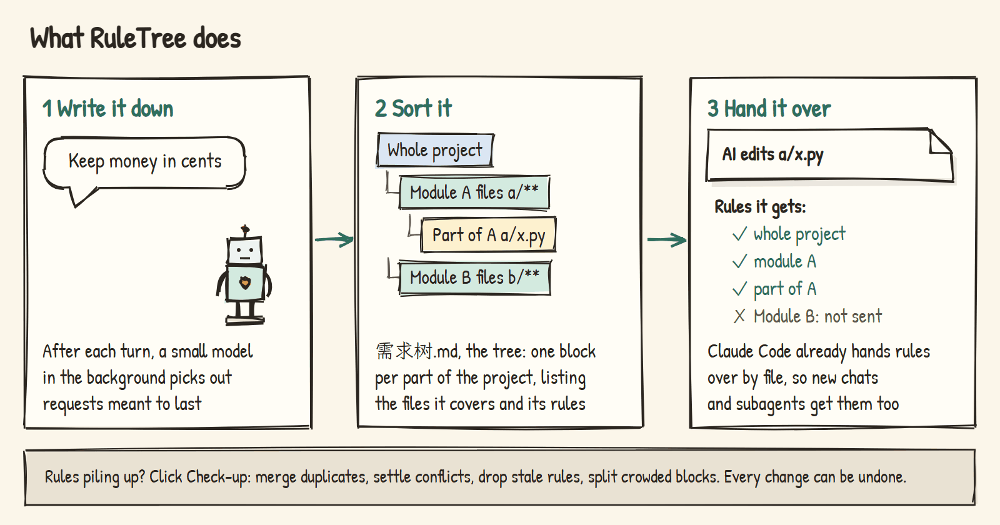

# RuleTree

An information architecture designed for AI coding: rules, docs and code maps each in their place, kept tidy for you, and the AI reads only the rules for the file it is editing.

A VS Code extension for [Claude Code](https://claude.com/claude-code) and [OpenAI Codex](https://developers.openai.com/codex). English | [中文](README.md)



Three weeks into building a project with an AI, you have told it dozens of things: comments in English, opening hours come from the config, shopkeepers stay inside their shop. Those requests are scattered across chat history, CLAUDE.md, the AI's own memory and your design docs. Start a new chat and the AI can no longer see what was said in the old one. Put everything in CLAUDE.md and it reads tens of thousands of words before fixing a typo. Change your mind one day, and the old wording survives in two other places, so the AI cannot tell which one to follow.


In one of the author's projects, 21 documents holding rules turned out to contain 237 duplicates, contradictions and outdated statements. RuleTree gathers those requests into one file in your project and sorts them by the files they cover. When the AI edits a file, it gets only the few rules that cover that file. The rest of this page walks through one example, a small town-management game.

## Everything in its place

RuleTree adds one file to your project, `需求树.md`, the tree. It splits the project into parts by what they do, such as shops, roads and saving. Each part is called a requirement, and a big part can hold smaller ones. Every requirement states two things: which files it covers, and the rules to follow when editing them. A rule is a request you can act on in one sentence. Here is the tree for the town game:

```markdown
# P Town game
- Comments in English

## R1 Shops
> Files: game/shops/**
> Docs: docs/shop-design.md
- Shopkeepers stay inside their shop

### R1.1 Shop door and opening hours
> Files: game/shops/shop_door.gd
- Opening hours come only from ShopHours
- Decision: the door announces opening and closing with a signal, not a direct call (easier to test on its own)
```

The number of `#` marks is the depth in the tree, and P, R1 and R1.1 are IDs. `> Files:` lists the files a requirement covers, `> Docs:` points to the design doc to read before working on it, and every line starting with `-` is a rule. A rule starting with "Decision:" records a choice you made between options, and the AI must ask you before overturning it.

Not everything belongs in a rule. RuleTree gives each kind of information its own place:

| What | Where it lives | When the AI reads it |
|---|---|---|
| A request you can act on in one sentence, like "opening hours come only from ShopHours" | The tree, under the requirement covering the files involved | Automatically, when it edits those files |
| A choice you made, and why | The same, starting with "Decision:" | The same; it must ask you before overturning it |
| What one sentence can't hold: why it is designed this way, how to do it, examples | A design doc, linked from the tree with `> Docs:` | When it edits those files, it first gets the doc's table of contents and reads only the sections it needs |
| Which files, functions and classes each part of the code already has | The code map, generated from your code | Whenever it wants to check before writing something new |
| Things unrelated to the project, like your computer setup | The AI's own memory | Claude Code manages it |
| What the project is and where things are | CLAUDE.md | Every time, so keep it short |

Each thing is written in one place: what can be acted on goes in the tree, what needs explaining goes in a doc.

## What the AI gets when it edits a file

When the AI edits `game/shops/shop_door.gd`, three levels cover that file: the whole game, shops, and shop door and opening hours. Their rules go to the AI; the rules for roads, saving and shelves do not.


The delivery relies on a feature Claude Code already has: a rule file in `.claude/rules/` can say "load me only when these files are read or written". RuleTree compiles each requirement into such a file, so delivery does not depend on the AI's memory. New chats, chats compacted after growing long, and subagents all get the rules. Codex has no such feature, so RuleTree uses an index plus top-ups there; see [docs/codex.md](docs/codex.md).

A smaller part can also replace one rule of a bigger part, within its own files. If the whole game says "functions stay under 40 lines" and the saving part says "save functions may run to 80 lines", the AI still keeps to 40 lines everywhere else.

## The recorder writes things down each turn

You don't write the tree yourself. After each turn, a cheap small model (Claude's Haiku) reads what you said in the background, picks out the requests meant to last, and files them under the requirement covering the files involved. This background model is the recorder. It takes about 6 seconds and you don't wait for it.


When you change your mind, it rewrites the old rule instead of adding another. When you pick one of several options, it records a "Decision:". Messages you send while the AI is working are passed to it too. When it is unsure whether to record something or where it belongs, it records its best guess and then asks you; pick another answer and it switches. If you'd rather not be asked, turn that off in the settings. Every change is listed under "Recent changes" in the sidebar, with an undo button.

## Check-up: tidying when rules pile up

After a few weeks the tree grows lopsided: the same thing recorded twice, contradicting rules, rules naming files that were deleted, one part carrying forty rules. Click "Check-up" in the sidebar.

RuleTree first finds suspects with plain code: similar rules that arrive together when one file is edited, file and class names that rules mention but the project no longer has, requirements with too many rules. A model then judges each suspect. Duplicates are merged, contradictions settled in favor of the later rule, stale rules removed, and crowded requirements split into smaller ones, with every rule moved over word for word. Requests scattered in CLAUDE.md, design docs and the AI's memory are moved into the tree as well.

At the end, the report gives the tree a score from 0 to 100 for how well it works: how much the AI receives per edited file on average, whether any rule can never be delivered, how many rules sit at the top and get sent with every file. The score is for comparing before and after, to see whether tidying helped. The author reorganized copies of two projects three times each:


In the game project, rules at the top dropped from 57 to 33, rules received per edited file from 74 to 55, and the score rose from 62 to 81. None of the three runs lost a rule or changed a rule's wording.

Even with rules written down, the AI slips. During a check-up, the model also picks out rules that one line of code is enough to judge, such as "no debug output left behind", and turns them into automatic checks. After the AI edits a file, RuleTree checks the lines it just wrote and warns it on the spot about a likely violation.


## The interface

| Sidebar (dark theme) | Map (light theme) |
|---|---|
|  |  |

| The requirement the AI is working on lights up | Which rules this chat loaded, and how long each is |
|---|---|
|  |  |

## Installing

You need Node.js 18 or later, VS Code, and Claude Code or OpenAI Codex. The easiest way is to open a Claude Code or Codex chat in your project and send it this:

```text
Install RuleTree in this project (https://github.com/penstic123-code/Rule-tree):
1. Run npx github:penstic123-code/Rule-tree init . (if you are Codex, add --tool codex at the end)
2. Download the latest reqtree-*.vsix from https://github.com/penstic123-code/Rule-tree/releases/latest, put it outside the project folder and tell me where
3. Don't run code --install-extension yourself; tell me how to install it in VS Code from the VSIX
```

Install the extension yourself: Extensions panel in VS Code → `…` → "Install from VSIX". Installing from the command line restarts the AI chats that are running. Then open the project and click "Enable". The extension has the AI read the project and builds a first tree in a minute or two; start a new chat and it is in use. For Codex, see [docs/codex.md](docs/codex.md).

## Test results

All experiments ran with real models on copies of two of the author's real projects: a Godot town game and a teaching project with six web courses.

### With RuleTree, does the AI read less, and follow rules better?

Sending rules by file should cut what the AI has to read, and reading less but more relevant material might mean fewer broken rules. To check, each project got 2 small tasks (a summary and exercises for a course chapter; an opening-hours hint and a delivery tip for the game), and the same rules were provided three ways: all in CLAUDE.md; with RuleTree; with RuleTree plus the whole code map handed to the AI. The AI really edited the files 8 times per setup, and another model counted the rules each edit broke.


The rules and notes to read shrank by 40 to 60 percent, but broken rules did not: about 1 per edit in all three setups for the course project, close to 0 for the game. On short tasks that end after one file, RuleTree makes the AI read less but has not yet made it follow rules better; long chats are untested. The full code map showed no benefit, so the AI now reads it only when it wants to.

### Are requests from real chats recorded correctly?

The messages the author typed in 12 real chats were replayed to the recorder in order, and a stronger model listed the rules those chats should have produced, as the answer key. The earlier recorder had one habit: a general request made while working on one part (such as "give the conclusion first") was often filed under that part, so the AI missed it when working elsewhere. The recorder now files rules by the files they govern:


Misfiling and wrong records dropped sharply, but misses went up. One cause found since: the recorder treated "picking one of several options" and criticism of its output as one-off remarks. The prompt has been changed; not yet retested.

### How does it compare with letting the AI keep its own rules doc?

A simulated 32-turn chat: the user makes 13 lasting requests, then changes their mind, cancels some and adds exceptions; at the end, are the recorded rules right? When the AI keeps its own notes and the user says "drop the reflection questions", it often adds "no reflection questions" and leaves the old rule in place. RuleTree deletes the cancelled rule.


### Does reorganizing lose or change rules?

Each project was reorganized 3 times: no rule lost, no wording changed, no "Decision:" missing. Three faults were also planted in the copies to see whether a check-up finds them. A top-level rule that only concerns code was moved under the "code conventions" part all 6 times, and turned into an automatic check. A rule telling the AI to use a class that no longer exists was judged stale and removed all 8 times. Two design docs that contradict each other were caught 3 times out of 3 in the course project; in the game project, with many more docs, never. The comparison has since been changed and not yet retested.

## Compared with other approaches

| Approach | Does | Doesn't |
|---|---|---|
| Put every rule in CLAUDE.md | Read at the start of every task | Read in full for every edit, keeps growing; you maintain it |
| The AI's automatic memory | Saves some things you said | Doesn't know which part of the project a rule belongs to; gets messier |
| Write your own rules docs | As detailed as you like | You keep them updated; the AI doesn't know when to read which |
| [graphify](https://github.com/safishamsi/graphify), [aider's repo map](https://aider.chat/docs/repomap.html) | Help the AI understand code structure, better than RuleTree's code map | Don't handle your requests and rules; no GDScript |
| RuleTree | Records requests, sorts them by part, delivers them by file; tidies and scores itself | The recorder misses and misfiles some, so you fix or undo; not yet shown to make the AI follow rules better |

## FAQ

<details>
<summary>Doesn't the AI already remember what I said?</summary>

Within one chat, yes. After a new chat, compaction of a long chat, or in a subagent, it can't see it. RuleTree keeps the rules in a file and puts them in front of the AI when it edits the files they cover.
</details>

<details>
<summary>With thousands of files, how does the AI know which rule applies where?</summary>

It doesn't have to look. Each requirement states which files it covers, and Claude Code hands over the rules covering a file whenever the AI reads or writes it.
</details>

<details>
<summary>Is it slow? Will it keep asking me things?</summary>

The recorder runs once per turn in the background, about 6 seconds, without holding you up; a check-up on a large project takes a few minutes. When unsure, it records its best guess and asks you once; ignoring the question doesn't block anything. Turn the questions off in the settings and it asks only before overturning one of your "Decision:" rules.
</details>

<details>
<summary>Will the AI follow rules better with RuleTree?</summary>

Not shown yet. What has been measured is 40 to 60 percent less for the AI to read, and rules that no longer contradict each other across places. That is why the checks right after each edit were added.
</details>

## Limits

- Not yet shown to make the AI follow rules better.
- Rules are delivered by file. A project that keeps everything in one file can't get just part of them.
- The recorder relies on a small model; replaying real chats, it missed about a fifth of the rules and recorded about 5% wrong, which you fix or undo in the panel.
- Contradictions between design docs are only found within the same part of the project.
- The code map reads code with regular expressions and may miss things in less common languages.
- Codex has no load-by-file feature, so RuleTree uses an index plus top-ups there.
- Developed on Windows; Mac and Linux are covered by automated tests.

## For developers

Design notes: [docs/architecture.md](docs/architecture.md) and [docs/design-info-architecture.md](docs/design-info-architecture.md). The setup and run-by-run results of every experiment are in [docs/test-log.md](docs/test-log.md).

```bash
node --test test/*.test.js             # all automated tests
node bin/reqtree.js                    # command-line usage
node bin/reqtree.js health 需求树.md   # score a tree
```

Image sources are in `docs/images/src/`. Don't force-reinstall the extension from the command line while using Claude Code; it restarts Claude Code too.

## License

MIT
