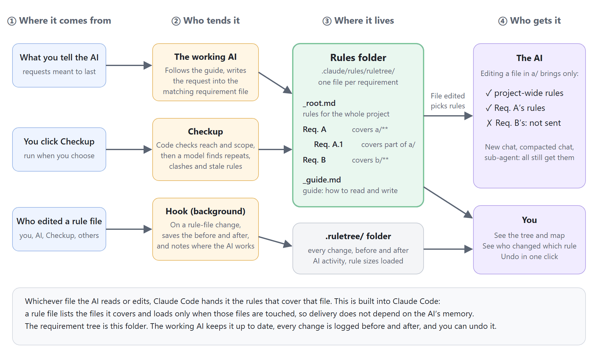

# RuleTree

An information architecture designed for AI coding: one rule file per requirement, the AI reads only the ones that cover the file it is editing, and every change to a rule is logged and can be undone.

A VS Code extension for [Claude Code](https://claude.com/claude-code). English | [中文](README.md)



Technically it does three things: each requirement becomes one rule file whose header lists the files it covers; Claude Code's built-in path rules hand the AI only the files that cover whatever it is reading or editing; and the extension logs the before and after of every change so you can undo it.


Three weeks into building a project with an AI, you have told it dozens of things: comments in English, store money as whole cents, run the tests after every edit. Those requests are scattered across chat history, CLAUDE.md, the AI's own memory and your design docs. Start a new chat and the AI can no longer see what was said in the old one. Put everything in CLAUDE.md and it reads tens of thousands of words before fixing a typo. Change your mind one day, and the old wording survives in two other places, so the AI cannot tell which one to follow.


In one of the author's own projects, 21 documents that contained rules turned out to hold 237 duplicated, contradictory or outdated statements. RuleTree gathers those requests into one folder in the project, with one file per requirement, and each file says which project files it covers. When the AI edits a file, Claude Code hands it only the requirement files that cover it.

## Every kind of information in its place

A project holds more than rules: design docs, the code itself, the AI's memory, CLAUDE.md. Deciding where each kind lives, and when the AI gets to read which, is the project's information architecture. Arrange it badly and the same thing is written in several places while the AI reads piles it doesn't need. Arrange it well and each thing lives in one place, and the AI has exactly what it needs while it works.

RuleTree centres that arrangement on the folder `.claude/rules/ruletree/`. It splits the project into parts by what they do; each part is a requirement, a large part can have smaller parts under it, and each requirement is one file. In an online shop, the refunds part lives in `R1.1-Refunds.md`:

```markdown
---
paths:
  - "src/payment/refund.ts"
---
# R1.1 Refunds 🔨
Parent: R1 Payments
Docs: docs/payment-design.md#Refunds
- Check the order status before refunding
- Decision: refunds go through the message queue, not straight to the payment API (so failures can be retried)
```

The `paths:` at the top says which files the requirement covers; the title line holds the ID, name and status; `Docs:` points to the design doc to read before changing this part; every line starting with `-` is a rule. The hierarchy follows the IDs: R1.1 sits under R1, which covers all of `src/payment/`, and at the very top a `_root.md` holds the rules for the whole project. A rule that starts with "Decision:" is a choice you made between options, and the AI has to ask you before overturning it.

Everything that isn't a rule has its own place:

| What | Where it lives | When the AI reads it |
|---|---|---|
| A request you can follow from one sentence, like "store money as whole cents" | In the file of the requirement that covers the relevant files | Automatically, whenever it touches those files |
| A choice you made, with the reason | Same place, starting with "Decision:" | Same; it must ask you before overturning it |
| What one sentence can't hold: why it is designed this way, how to do it, examples | A design doc, linked from the requirement file with `Docs:` | Before it touches those files; only the relevant section of a long doc |
| Things unrelated to the project, like your machine setup | The AI's own memory | Claude Code manages that itself |
| What the project is, where things live | CLAUDE.md | Every time, so the shorter the better |

The requirement files are ordinary Claude Code rule files. Commit them to git and teammates and git worktrees all see the same tree.

## What the AI receives when it edits a file

When the AI edits `src/payment/refund.ts`, three levels cover that file: the whole shop, payments and refunds. The rules of those three go to the AI; the rules for login, product pages and coupons don't.


Delivery relies on a Claude Code feature called path rules: a rule file in `.claude/rules/` whose header lists `paths:` loads only when the AI reads or writes those files. Nothing depends on the AI's memory, so the rules still arrive in a new chat, after a long chat is compacted, and inside sub-agents.

A smaller part can also rewrite one of a larger part's rules, and the rewrite counts only for its own files. If the shop says "functions under 40 lines" and payments says "payment functions may run to 80 lines (in this scope, replaces P's "functions under 40 lines")", the AI still keeps to 40 lines everywhere else.

## The working AI records the rules itself

The folder holds a `_guide.md`, a short guide RuleTree writes for the AI, loaded in every chat. It tells the AI that when you state something to follow from now on, or settle on one option, it should write it into the matching requirement file before the turn ends. The rule goes into the requirement that owns the file being edited; only what you explicitly say applies project-wide goes into `_root.md`; a change of mind rewrites the old rule instead of adding a second one; afterwards the AI says "recorded in R1.1" in its reply.

The AI already has the requirement file for the code it is editing loaded, so it knows where the rule belongs. RuleTree's hook watches in the background: each time the AI edits a rule file, it logs a change under Recent changes in the sidebar, and a wrong one can be undone. Undo reverses only that change, so rules added to the same file later stay.

## Checkup: tidying up when rules pile up

After a few weeks the tree drifts. The same thing gets recorded twice, two statements contradict each other, a rule mentions a file that has since been deleted, one part carries forty rules. That is when you press Checkup in the sidebar.

RuleTree first runs program checks: requirements whose files match nothing (their rules never load), requirements with no `paths:` (their rules load every time), children reaching outside their parent's files, attached docs that are missing, requirements with too many rules. Two rules that say exactly the same thing lose one copy straight away. Then it calls the model once to find duplicates, contradictions and outdated rules: what it can fix it fixes, the later statement winning; rules starting with "Decision:" stay untouched and go into the report for you to decide. All the changes form one entry that can be undone at once. If no rule changed since the last checkup, the model isn't called.

## The interface

| Sidebar (dark theme) | Map (light theme) |
|---|---|
|  |  |

| The requirement the AI is working on lights up | Which rules this chat loaded, and how long each is |
|---|---|
|  |  |

The sidebar can rename, change status, add rules and change a requirement's files, all written back to the requirement's file. You can also open a rule file in the editor and change it there; saving logs the change under Recent changes too.

## Install

You need Node.js 18+, VS Code and Claude Code. The easiest way is to open a Claude Code chat in your project and send it this:

```text
Install RuleTree (https://github.com/penstic123-code/Rule-tree) in this project:
1. Run npx github:penstic123-code/Rule-tree init .
2. Download the latest ruletree-*.vsix from https://github.com/penstic123-code/Rule-tree/releases/latest, put it outside the project folder, and tell me where
3. Don't run code --install-extension yourself; tell me how to install it from VSIX in VS Code
```

Install the extension yourself: VS Code Extensions panel → `…` → Install from VSIX. Installing from the command line restarts the running AI chat too. Then open the project and click Enable. RuleTree creates a first set of requirements from the project's top-level folders, and the next chat you start uses them. If you used the old version (the project has a `需求树.md`), opening the project splits it into rule files and keeps the original in `.ruletree/legacy/`; uninstall the old extension (reqtree) first.

## Measurements

All experiments use real models on copies of two of the author's own projects. Project A is a game with a few hundred code files and over three hundred rules; project B is a teaching website with six web courses.

### With rules sent by file, does the AI read less and follow the rules better?

Sending rules by file should mean less for the AI to read, and reading less but more precisely might mean fewer broken rules. To check, each project got two small tasks, such as adding an opening-hours notice to project A and a chapter summary to project B. The same rules were placed two ways: all in CLAUDE.md, or sent by file. Each arm had the AI really make the change 8 times, and another model checked every applicable rule against each change and counted violations.


The AI had 40–60% fewer words of rules and instructions to read, but it broke no fewer rules: close to zero in every arm on project A, about one per change in every arm on project B. On short tasks that end after one file, sending by file makes the AI read less without yet making it follow rules better. Long chats haven't been measured.

### Why the background recorder is gone

The old version had a cheap model read each turn in the background and write rules into the tree. Replaying 12 of the author's real chats in order, with a stronger model listing the rules that should have been recorded as the answer key, the recorder missed about a fifth, filed rules under requirements that didn't cover the relevant files, recorded passing questions as requirements, and added 8 to 15 seconds to each turn. The working AI already has the file of the requirement it is editing, so it records more directly. How accurately it records hasn't been measured yet.

## Compared with other approaches

| Approach | What it does | What it doesn't |
|---|---|---|
| Put every rule in CLAUDE.md | The AI reads them at the start of every task | Reads the whole file whatever it edits; keeps growing |
| The AI's auto memory | Records some things automatically | Doesn't know which part of the project a rule belongs to; gets messier |
| Hand-written rules in `.claude/rules/` | Uses the same mechanism as RuleTree | No tree or map to see what covers what; no undo; nothing tells the AI where to record |
| RuleTree | Sorted by part, delivered where the AI edits; the AI records rules by the guide and every change can be undone; checkup tidies duplicates and contradictions | The AI can still miss or misfile rules, which you fix or undo; not yet shown to make the AI follow rules better |

## FAQ

<details>
<summary>Doesn't the AI remember what I told it?</summary>

Within one chat, yes. In a new chat, after a long chat is compacted, or in a sub-agent, it can't see it. RuleTree keeps rules in files and puts them in front of the AI when it touches the relevant files.
</details>

<details>
<summary>With thousands of files, how does the AI know which rule applies where?</summary>

It doesn't need to look. Each requirement states which files it covers, and Claude Code hands the AI the covering rules whenever it reads or writes a file. While you are only discussing a requirement and nothing has been touched yet, the guide tells the AI to read that requirement's file first; the file name contains the requirement's name.
</details>

<details>
<summary>Is it slow?</summary>

No model runs in normal use; the hooks run in the background. Only Checkup calls the model, once, and not at all if no rule changed.
</details>

<details>
<summary>Will the AI follow rules better with RuleTree?</summary>

That hasn't been shown yet. What has been shown is 40–60% less for the AI to read, and rules no longer scattered across places saying different things.
</details>

## Current limits

- Not yet shown to make the AI follow rules better.
- Rules are sent by file. In a project where everything lives in one file, there is no way to send only part.
- The working AI records the rules itself and can miss or misfile some; you fix or undo them in the panel.
- When the AI edits a rule file through the command line rather than its edit tools, the hook can't tell it was the AI and logs the change as "Other".
- Claude Code only for now; OpenAI Codex has no file-based rule loading, and support is still being built.
- Developed on Windows; Mac and Linux are covered by automated tests.

## For developers

The design is described in [docs/architecture.md](docs/architecture.md) (Chinese); the conditions and run-by-run results of every experiment are in [docs/test-log.md](docs/test-log.md).

```bash
node --test test/*.test.js             # all automated tests
node bin/ruletree.js                   # command-line usage
```

Image sources are in `docs/images/src/`. Don't force-reinstall the extension from the command line while using Claude Code; it restarts Claude Code too.

## License

MIT
