# ReqTree

**As the project grows, you and the AI both still know what it looks like right now.**

A VS Code extension for [Claude Code](https://claude.com/claude-code) and [OpenAI Codex](https://developers.openai.com/codex). **English** | [中文](README.md)

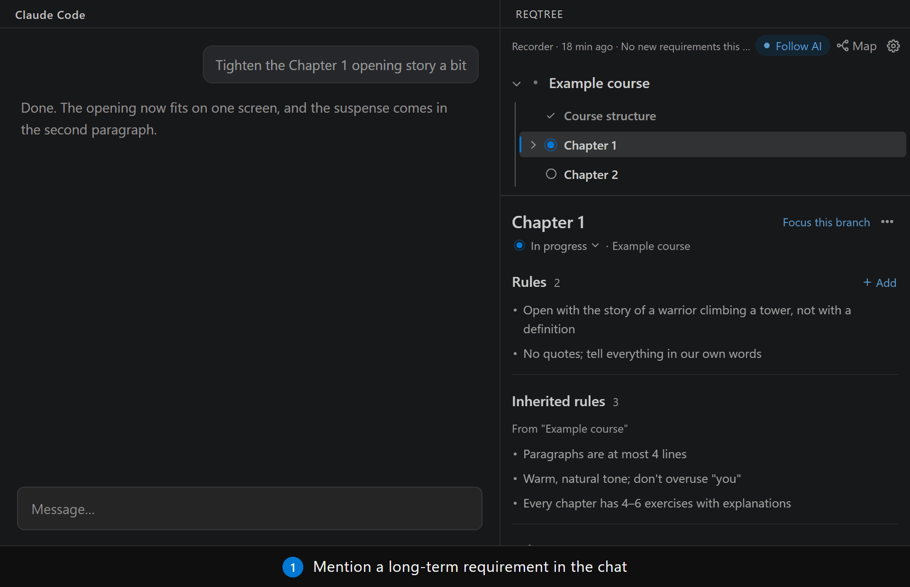

Say "end every chapter with a reflection question" in chat. When the turn is over, it appears in the tree in the sidebar. Next week, when the AI edits that chapter again, it follows the rule without being told.

## Sound familiar?

Building code, a course or a game with an AI goes smoothly for the first few days. Once the project grows, these start to show up.

**You can no longer say what the project looks like.** A feature has been changed three times; a plan from three weeks ago was overturned twice. What's done, what's in progress, which version of a rule is current: you have to dig through chat history to remember.

**You've said the same thing several times, and the AI still forgets.** Within one conversation, the AI remembers what you said. It forgets at three moments: when you start a new conversation; when the conversation gets long and the earlier part is squeezed into a summary; and when the AI sends out a "sub-agent" (another AI it calls in to help), which never sees your conversation at all.

**The AI doesn't know which task a rule belongs to.** While working on chapter 3 you say "every example needs a picture". Is that only for chapter 3, or for every chapter from now on? The AI's built-in "auto memory" writes it down, but not which task it belongs to. So chapter 3's rule shows up while editing chapter 5, and as notes pile up they start contradicting each other.

**Rules are scattered, and they disagree.** The same rule was said in chat, written into CLAUDE.md (the instructions file Claude Code reads every time it starts), saved in the AI's memory, and copied into a project doc. Later you changed your mind and updated only one of them. I checked my own course project, several months old: 21 rule documents, over 80,000 characters, with 237 duplicates, contradictions and outdated rules.

**The bigger the project, the more the AI reads every time it starts.** CLAUDE.md keeps growing and is read in full in every conversation; a style guide runs to thousands of words and is read top to bottom to change one comma; the AI doesn't know where code lives, so it searches everywhere. Every word it reads costs money and takes up room in the conversation.

**The AI reinvents the wheel, or writes code that fights other code.** There's already a function for it in the project, but the AI doesn't know and writes a near-copy.

## How ReqTree solves it

Here's one example, start to finish. You're building a data science course and working on chapter 3.

**Step 1: you just talk; it takes notes in the background.** You say in passing "every example in this chapter needs a picture". When the turn is over, a background helper (the "recorder") reads this, and decides it's a lasting requirement rather than a one-off instruction like "shorten this paragraph". It knows you're working on chapter 3, so it writes the sentence into a file in your project called `需求树.md` (the tree), under "Chapter 3". You don't do anything.

The recorder relies on a small model and sometimes gets it wrong: say you meant pictures for this chapter only, and it recorded "every chapter needs pictures". Open "Recent changes" at the bottom of the sidebar, where every change is listed (when, which requirement, what it became), find the wrong one and click "Undo" next to it. The tree goes back to how it was before.

**Step 2: next time the AI edits chapter 3, the rule shows up by itself.** Next week you start a new conversation and ask the AI to edit chapter 3. As soon as it opens chapter 3's file, "every example needs a picture" appears in front of it, without you saying it again. When it edits chapter 5, the rule doesn't appear, because it belongs to chapter 3 only. Rules reach the AI by file: for any task, the AI reads only the rules inherited from the levels above plus the task's own rules, and nothing from other tasks.

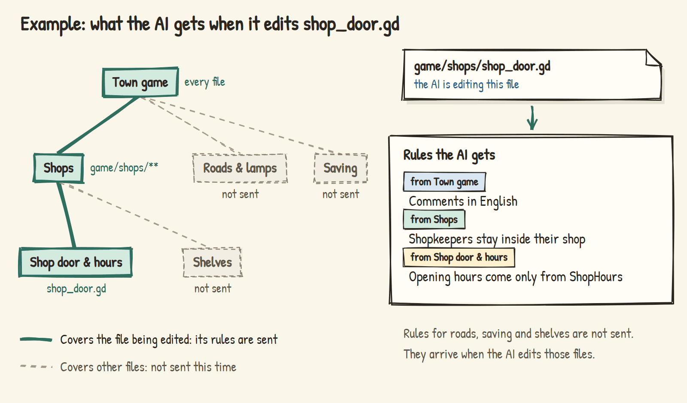

**Step 3: you can see the whole picture at any time.** The sidebar shows a tree: each course and each chapter is a "requirement", with its rules and status (in progress, to do, done). Whichever chapter the AI is editing lights up.

**Step 4: as rules pile up, it tidies them.** Over time some rules repeat, some contradict, some go stale. Click "Check-up" and it merges duplicates, resolves contradictions and clears out stale ones. Every change can be undone; it only asks you when it genuinely can't decide.

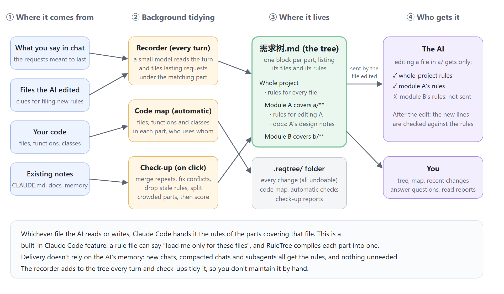

## Rules, docs and memory: what goes where

A project's information comes in several kinds. Mixed together, it costs tokens and drifts out of sync. ReqTree gives each kind a fixed place:

| Where | What | Example | When the AI reads it |
|---|---|---|---|
| **Rules** (in the tree) | A requirement you can follow from one sentence | "Every example needs a picture", "Paragraphs at most 4 lines" | Shows up automatically when the matching files are touched |
| **Decisions** (rules starting with "Decision:") | The option you chose among several, with the reason | "Decision: charts are plain SVG, no chart library (pages must open offline)" | Same; the AI must ask you before overturning one |
| **Docs** (attached to requirements) | What a rule can't hold: why, how exactly, examples, data, progress | A chapter list, the detailed reasoning of a style guide, an architecture note | When the matching files are touched, the AI is told to read the contents first and only the sections it needs |
| **Code map** (generated) | What's already in this part of the code | "This area has `common.js`, which provides `DS.toast`…" | Shows up automatically when the matching files are touched |
| **The AI's auto memory** | Things unrelated to the project's content | Your machine, your personal habits | Managed by Claude Code |
| **CLAUDE.md** | The project's front door: what it is, where things are | A dozen lines is enough | Read every time, so the shorter the better |

**Rules vs docs**: if it can be written as one "do…" or "don't…" that you can simply follow, it's a rule; if it needs explanation, examples or data, it's a doc. Rules say *what*; docs say *why* and *how exactly*. Each thing is written in one place only: when a check-up finds a doc line stating a rule the tree already has, it deletes that line from the doc (after a backup, and undoably).

**Long docs: read only the sections that matter.** The AI doesn't need all of a several-thousand-word style guide to fix one comma. ReqTree gives every long attached doc a table of contents: each section's title and line range. The AI reads that short list first, then only the sections relevant to the task. You can also attach a single section to a requirement, so "Writing" gets only the "Writing style" section of the guide: put `> docs: guides/writing.md#Writing style` under the requirement.

**A file can belong to several requirements.** For example, "Writing" covers every course's chapter pages, and "Data science course" covers all of that course's files. Editing a data science chapter page brings in both sets of rules; editing the course's scripts leaves the writing rules out. So a shared writing guide is written once, not copied into every course. When the two disagree, the one covering the narrower set of files wins.

## The interface

| Sidebar (dark theme) | Map (light theme): click a requirement and the other branches fade |
|---|---|
| 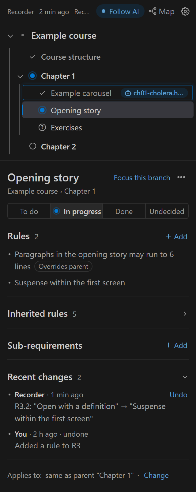 | 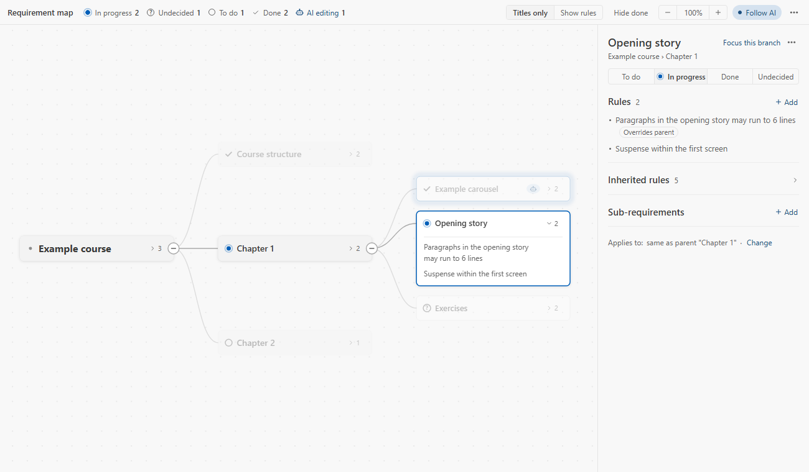 |

| Focus on one branch | Context usage: which rules this conversation read, and how long each is |
|---|---|
| 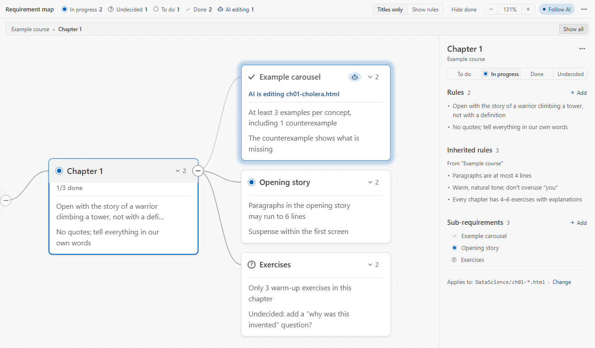 | 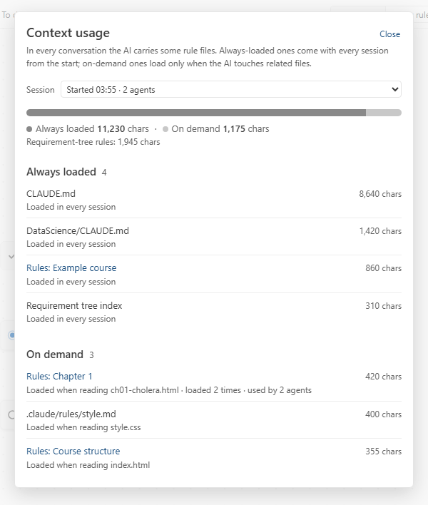 |

In the sidebar, requirements in progress come first, and finished ones fold into a single "N done" line. The interface comes in English and Chinese; if your tree is written in Chinese, it uses Chinese.

## Installing

**You need** Node.js 18 or later, VS Code, and Claude Code or OpenAI Codex.

### Let the AI install it

Open a Claude Code or Codex conversation in your project and send it this:

```text
Install ReqTree (https://github.com/penstic123-code/Vibe-Friend) in this project:
1. Run npx github:penstic123-code/Vibe-Friend init . (if you are Codex, add --tool codex at the end)
2. Download the latest reqtree-*.vsix from https://github.com/penstic123-code/Vibe-Friend/releases/latest, put it outside the project folder, and tell me where
3. Don't run code --install-extension yourself; tell me how to install it from VSIX in VS Code
```

Install the extension by hand: installing an extension from the command line inside VS Code restarts the running AI conversation along with it, so it can't finish what it was saying. Once it's installed, start a new conversation.

### Install it yourself

1. Download `reqtree-<version>.vsix` from [Releases](https://github.com/penstic123-code/Vibe-Friend/releases), then in VS Code's Extensions panel → `…` → "Install from VSIX".
2. Open your project. The extension asks "Enable ReqTree in this project?"; click "Enable".
3. Start a new Claude Code conversation and work as usual.

To stop using it, choose "Disable ReqTree in this project" in the sidebar's gear menu. The tree file stays, so you can turn it back on later.

Command line only:

```bash
npx github:penstic123-code/Vibe-Friend init <your project folder>               # Claude Code
npx github:penstic123-code/Vibe-Friend init <your project folder> --tool codex # OpenAI Codex
```

For Codex specifics, see [docs/codex.md](docs/codex.md).

## What the tree looks like

`需求树.md` is a plain Markdown file. You can edit it directly, or do everything by clicking in the sidebar.

```markdown
# P Example course
- Paragraphs at most 4 lines                ← top-level rule: applies to the whole project

## W Writing
> 文件：*/ch*.html                          ← the files this requirement covers: every course's chapter pages
> 文档：guides/writing.md#Writing style     ← attach only the "Writing style" section of the guide
- One new idea per paragraph

## C2 Data science course 🔨
> 文件：DataScience/**                      ← all of this course's files
> 文档：DataScience/_CHAPTERS.md            ← chapter list: the AI is told to check it before editing this course
- No direct quotes; retell everything
- Decision: charts are plain SVG, no chart library (pages must open offline)

### C2.3 Chapter 3 🔨
> 文件：DataScience/ch03-*.html
- Every example needs a picture
```

- A heading starting with `#` is a "requirement": an ID first, a status last (✅ done 🔨 in progress ⏳ to do ❓ undecided)
- Each line under it starting with `-` is a rule
- `> 文件：` (or `> files:`) says which files the requirement covers; `*` means any file name, `**` any number of folders. Without it, the requirement inherits its parent's files
- `> 文档：` (or `> docs:`) attaches a reference doc; add `#` and a section name to attach just that section

### Requirements and sub-requirements, rules and sub-rules

The number of `#`s is the level: `### C2.3 Chapter 3` under `## C2 Data science course` is its **sub-requirement**. A sub-requirement usually covers part of its parent's files: the course covers all its files, chapter 3 only chapter 3's pages.

**Rules from the level above apply below too.** When the AI edits chapter 3 it reads three layers: the project's (paragraphs at most 4 lines), the course's (no direct quotes), and chapter 3's (every example needs a picture). So a rule is written once, at the highest level it applies to, not copied into every chapter.

**A lower level can replace one of the upper level's rules, within its own scope.** Say the project limits paragraphs to 4 lines, but chapter 1's opening should run longer. Give both rules the same name (the word in square brackets) and the lower one replaces the upper one:

```markdown
# P Example course
- [para] Paragraphs at most 4 lines

### C2.1 Chapter 1
- [para] The opening may run to 6 lines     ← replaces the rule above, in chapter 1 only
```

When editing chapter 1, the AI reads "the opening may run to 6 lines"; for every other chapter it's still "at most 4 lines". If you say "chapter 1's opening can be longer" in chat, the recorder writes it in this form for you.

## Other features

**When it's unsure, it asks.** Some things only you can settle: does "chapter 5 can have a few more interactions" make an exception for that chapter, or apply to every chapter from now on? In cases like this the recorder writes down the most likely reading (by default, just the requirement you're working on) and shows a notification in VS Code with options. You can ignore it; the first reading stays in effect.

**Check-up.** Rules used for long enough repeat, contradict and go stale. Click "Check-up" in the sidebar and it:

- merges duplicate rules, and removes a sub-requirement's rule that repeats one from above
- resolves contradictions: if one rule is clearly the later word, that one wins; it asks you only when it can't tell
- splits a requirement with too many rules into sub-requirements when the rules divide by file (e.g. half of them only concern chapter pages)
- tidies the AI's auto memory: notes already in the tree are deleted, project rules move into the tree
- tidies docs and CLAUDE.md: lines that repeat the tree are deleted, rules that belong in the tree move there

Every change is logged in "Recent changes" and can be undone; anything you undo stays undone on later check-ups. A report is written at the end; open it from "Last check-up report" in the gear menu.

**Code map.** Before the AI edits an area of code, it automatically gets a "map" of it: the files there, the description at the top of each, the functions and classes they provide, the shared modules the area depends on, and the signals it emits and listens to. To find where a function is defined and who uses it, the AI runs a lookup command. The map uses no model; a few hundred files take about a second, and it updates as the code changes. It understands JavaScript/TypeScript, Python, Godot's GDScript and the scripts a web page loads; other languages are read by their usual patterns.

**Working principles.** Every time it starts work, the AI reads three principles: when there's a bug, find the root cause first, and fix contradicting rules or unsound architecture before patching symptoms; before writing something new, check whether the project, the standard library or an installed dependency already has it (borrowed from [ponytail](https://github.com/DietrichGebert/ponytail)); and don't just do what you're told: when your request clashes with how the project actually is or how maintainable it will be, point out the problem and suggest a better way, then wait for your call.

**Settings.** Everything is in the sidebar's gear menu: how often to record (every turn, every 3 turns together, or paused), the code map, working principles and recording what the AI finds out, sort order, and disabling.

## Common questions

**Doesn't the AI already remember what I said?**
Within one conversation, yes. The trouble is when it can't see: a new conversation knows nothing of the last one; a long conversation gets squeezed into a summary; a sub-agent never sees your conversation, and the main AI only gets the sub-agent's result back. ReqTree doesn't rely on the AI remembering. It keeps rules in files and puts them in front of the AI when they're needed.

**With thousands of files, and a rule buried in a few lines in some folder, how would the AI even know it exists?**
It doesn't have to look. Rules are compiled into Claude Code's built-in "load by path" mechanism: when the AI reads or writes a file, Claude Code hands it the rules that cover that file, sub-agents included. And the AI doesn't read thousands of files either; each time it reads only the few rules on the path to the current file.

**Wouldn't a well-organized project make this unnecessary?**
A tidy structure prevents a lot, but neat files aren't the same as well-kept rules. Rules keep growing, some contradict each other, and some are scattered across CLAUDE.md, memory and docs, each saying something different. ReqTree keeps them in order, continuously, without you doing it by hand. For newcomers who don't yet know how to organize a project, it also helps sort the project out: which files each task covers and which rules it follows.

**The AI won't mix up two contradicting rules, will it?**
When it can see the contradiction, it usually picks one, and not necessarily the one you meant most recently; when it can't see it, it can't notice. My course project had 237 duplicates, contradictions and outdated rules across 21 documents. ReqTree keeps each rule in one place, rewrites the old rule when you say something new, and the check-up finds the contradictions that remain.

## Compared with other approaches

| Approach | Does | Doesn't |
|---|---|---|
| Put every rule in CLAUDE.md | The AI reads it every time | Read in full no matter what you edit; keeps growing and costing tokens; you maintain it |
| The AI's auto memory | Writes some things down automatically | Doesn't know which task a rule belongs to; piles up and contradicts itself |
| Write your own rule docs | As detailed as you like | You record and update them yourself; the AI doesn't know which to read when |
| [graphify](https://github.com/safishamsi/graphify), [aider's repo map](https://aider.chat/docs/repomap.html) | Help the AI understand code structure, more thoroughly than ReqTree's code map | Only cover code, not your requirements and rules; neither supports GDScript |
| **ReqTree** | Records requirements automatically, sorts them by task, delivers only what the current edit needs, tidies duplicates and contradictions | The recorder occasionally files a rule in the wrong place; you undo or fix it |

## Test data

Each experiment answers one question. Raw data and conditions are in [`测试数据记录.md`](测试数据记录.md).

### Does the recorder get things wrong or add duplicates?

The recorder mostly meets a handful of situations: you restate an old rule in other words; you change your mind; you give a new rule; you ask for a one-off edit; you reject a rule. Run against the real model five times each, the recorder got every one right: no duplicates added, changed minds rewrote the original rule, one-offs weren't recorded.

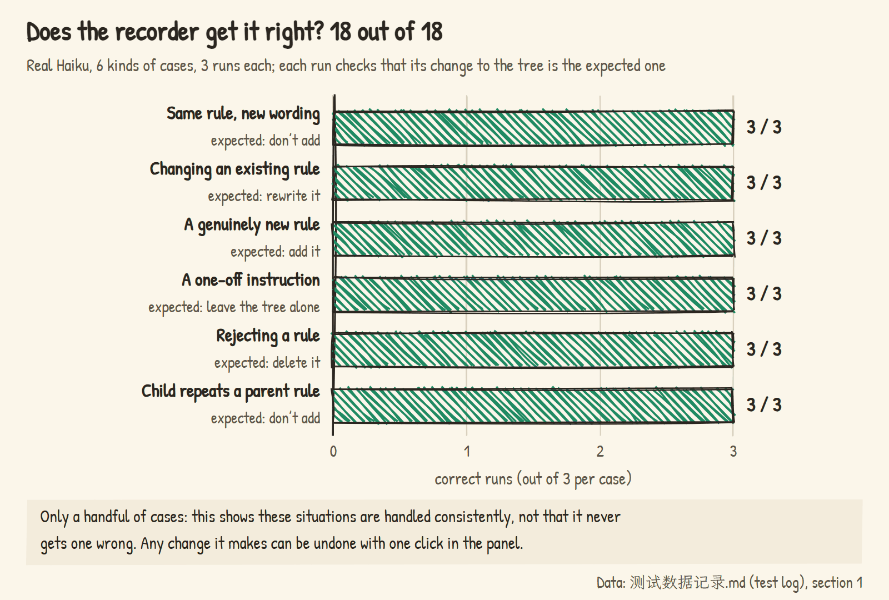

### Compared with letting the AI maintain its own rule document?

A simulated 32-turn conversation: the user gives 13 lasting requirements over time, changing their mind, cancelling and adding exceptions. One group lets the AI keep its own rule document; the other uses ReqTree. When the AI kept its own notes and you said "drop the reflection questions", it often added "no reflection questions" and kept the old rule too; an exception like "chapter 2 gets only 3 questions" sometimes became a global rule. ReqTree deleted the cancelled rule and put the exception under chapter 2.

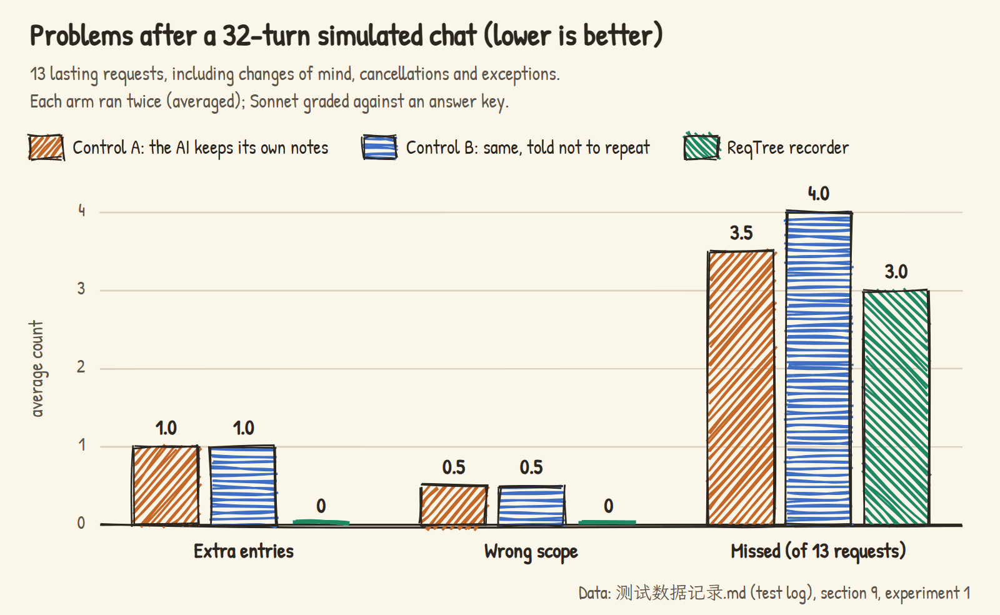

### How much does it save?

My course project used to read about 14,000 characters of CLAUDE.md plus rules at the start of every conversation. After moving the guides into docs and the rules under their requirements, the fixed part dropped to about 2,600 characters; the rest is read only when the matching files are touched. For any one chapter of any course, the AI reads 30–50% fewer rules.

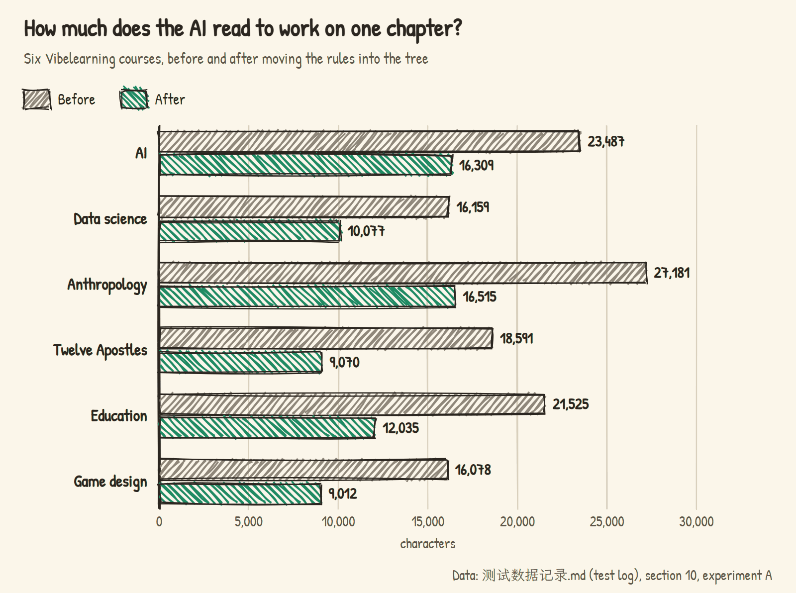

### Replaying real conversations

I replayed 436 messages I typed across 12 conversations over a few weeks, in order: one group let the AI record things its usual way into CLAUDE.md, memory and course docs; the other used ReqTree. ReqTree missed less, kept fewer overturned rules, and ended up with a rule base a third the size.

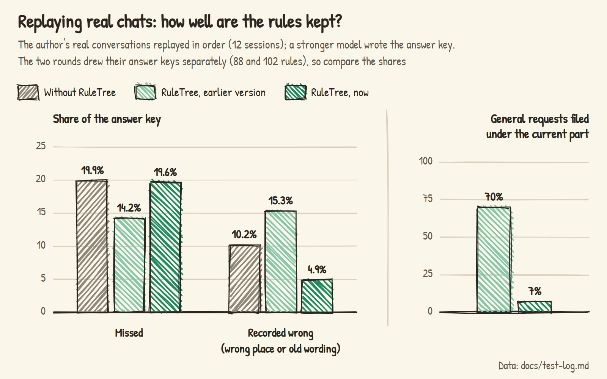

## Current limits

- Rules are delivered by file. It works best when different tasks touch different files; if everything lives in one file, there's no way to send only part of the rules. Which files a requirement covers can be changed at any time, down to a single file.
- The recorder relies on a small model and occasionally files a rule in the wrong place. When it notices it's unsure it asks; otherwise you fix it in the panel or undo it in "Recent changes".
- Each turn adds one small-model call, run in the background (about 6 seconds), so you don't wait. You can record every few turns instead.
- Codex has no "deliver rules by file" mechanism, so ReqTree uses an index plus top-ups; see [docs/codex.md](docs/codex.md).
- Developed on Windows; macOS and Linux are covered by automated tests.

## For developers

How it's built and why, see [docs/architecture.md](docs/architecture.md) (Chinese).

```bash
node --test test/*.test.js        # all automated tests (UI tests need Edge or Chrome)
node bin/reqtree.js               # command-line usage
```

**Note**: don't force-reinstall the extension from the command line (`code --install-extension --force`) while using Claude Code. It restarts VS Code's extension host, and Claude Code restarts with it.

## License

MIT
