# Vibe Friend · ReqTree

**Help your AI coding assistant remember the rules you set: every rule lives in one place, the assistant gets only the rules for the files it is editing, and the long-term requirements you mention in chat are recorded automatically.**

For [Claude Code](https://claude.com/claude-code) and [OpenAI Codex](https://developers.openai.com/codex), with a VS Code extension. **English** | [中文](README.md)

> 🚧 The code is getting its final cleanup and tests and will be uploaded here shortly. For now you can read the introduction and the test data.


*The extension UI is currently in Chinese; an English UI is planned.*

## Sound familiar?

You work with an AI assistant on a long project. A few weeks in, your rules are everywhere: said once in chat, written once in CLAUDE.md, stored once in the assistant's memory, copied again into a project doc. Then you change your mind, update one of those places, and the others keep the old version.

Requirements drift the same way. A feature gets revised again and again; the plan from three weeks ago has been overturned twice. Eventually even you can't say what the project currently looks like: which requirements are done, which are in progress, which version of a rule is the latest.

And the longer the conversation, the more the assistant forgets. After context compaction, the "paragraphs at most 4 lines" rule you agreed on early is gone. A subagent gets only some of the rules. Ask "what did we decide?" and it picks one of three contradicting documents.

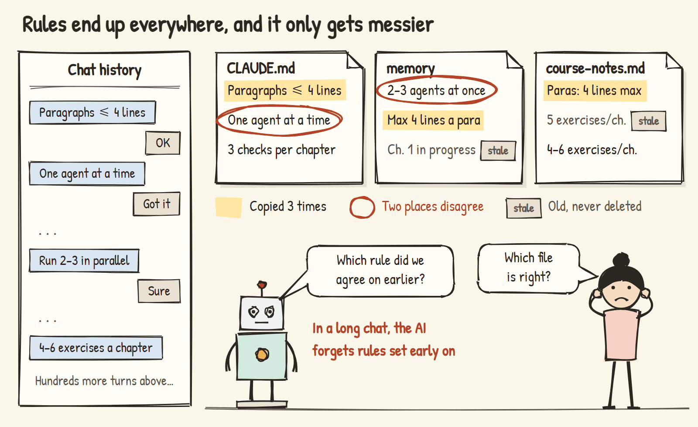

The author audited their own course project after a few months of work: 21 rule documents, over 80,000 characters, **237 duplicated, contradictory or outdated rules**. One document said "run only one agent at a time", another said "two or three chapters can run in parallel"; the same "three checks" rule had been copied 15 times.

## What it does for you

<table>
<tr>
<td width="50%" valign="top">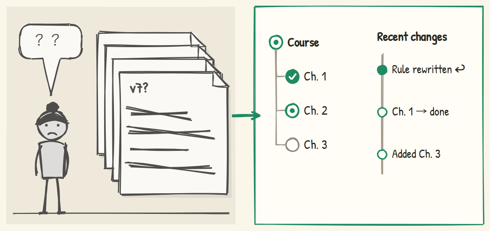<br><sub>Problem</sub><br>Requirements changed so often — what does the project look like now?<br><sub>ReqTree</sub><br><b>One tree shows it all: how far each part is, which rules are current; every change is logged and undoable</b></td>
<td width="50%" valign="top">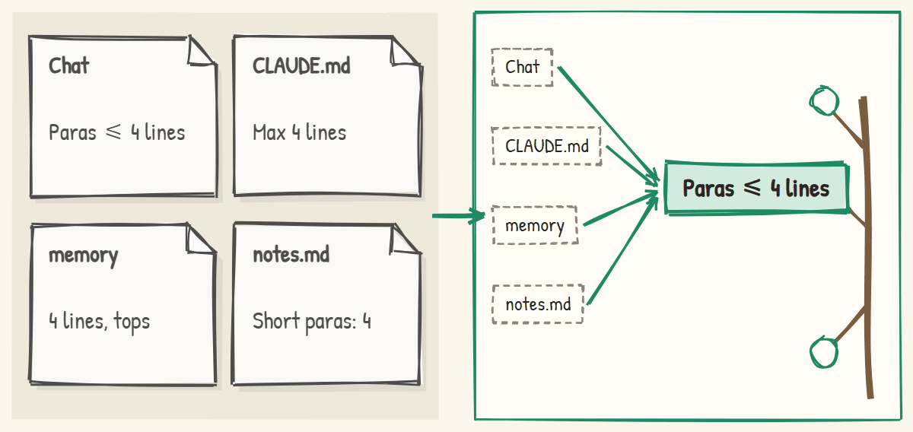<br><sub>Problem</sub><br>The same rule lives in four places. Which one counts?<br><sub>ReqTree</sub><br><b>Every rule lives in one file, in exactly one place</b></td>
</tr>
<tr>
<td width="50%" valign="top">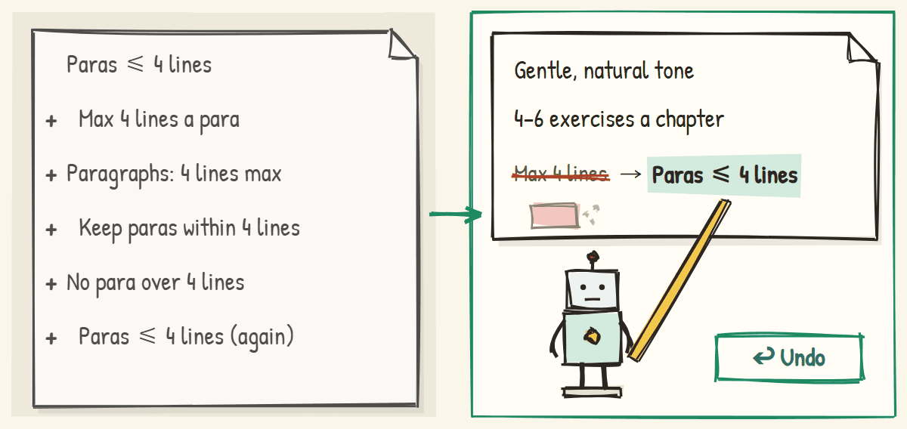<br><sub>Problem</sub><br>The same rule gets added again and again<br><sub>ReqTree</sub><br><b>The recorder rewrites the original instead of adding; undo in one click</b></td>
<td width="50%" valign="top">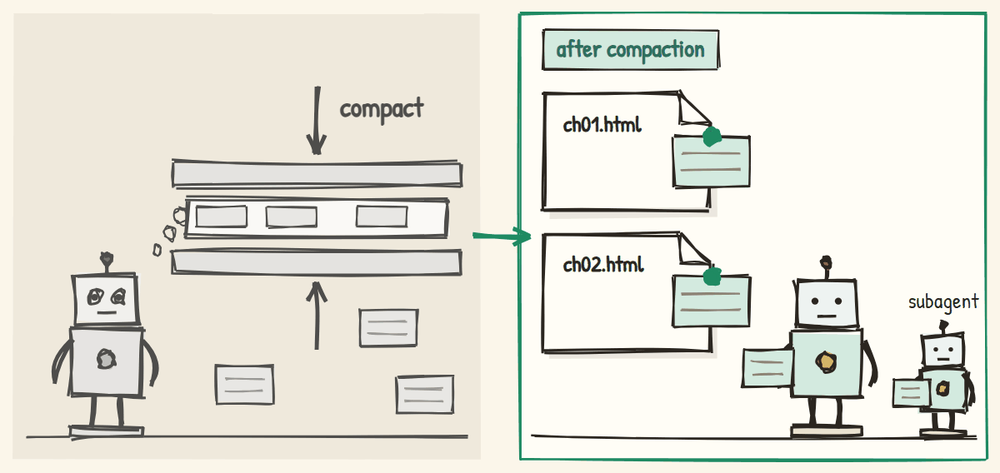<br><sub>Problem</sub><br>Long chats and compaction make the AI forget the rules<br><sub>ReqTree</sub><br><b>Rules use Claude Code's native mechanism and survive compaction and subagents</b></td>
</tr>
<tr>
<td width="50%" valign="top">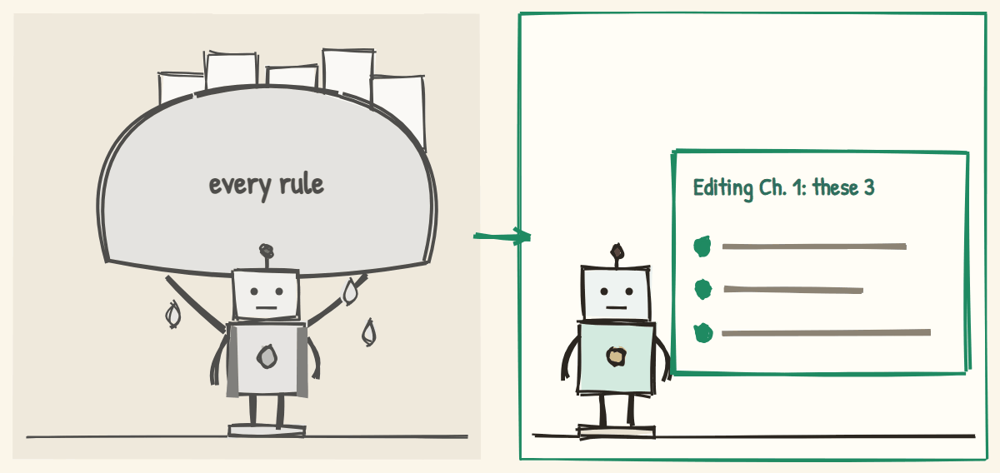<br><sub>Problem</sub><br>Every rule gets stuffed into the context<br><sub>ReqTree</sub><br><b>Only the rules for the file being edited come along</b></td>
<td width="50%" valign="top">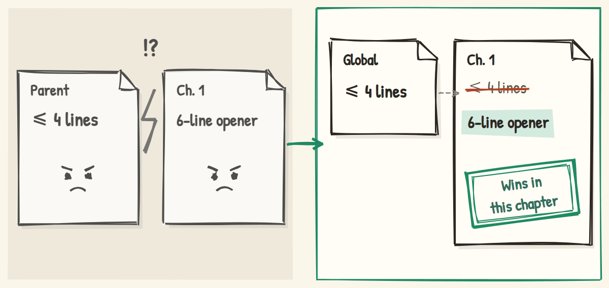<br><sub>Problem</sub><br>Parent and child rules contradict each other<br><sub>ReqTree</sub><br><b>A child requirement overrides its parent, only within its own scope</b></td>
</tr>
<tr>
<td width="50%" valign="top">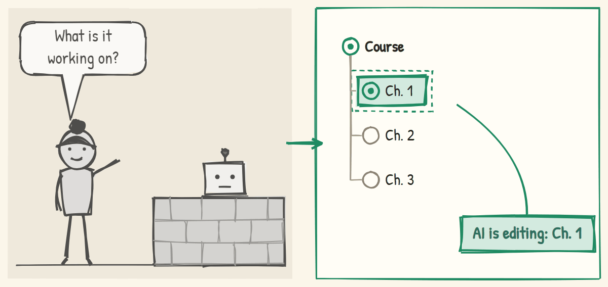<br><sub>Problem</sub><br>What is the AI working on right now?<br><sub>ReqTree</sub><br><b>The sidebar and map show it live</b></td>
<td width="50%" valign="top">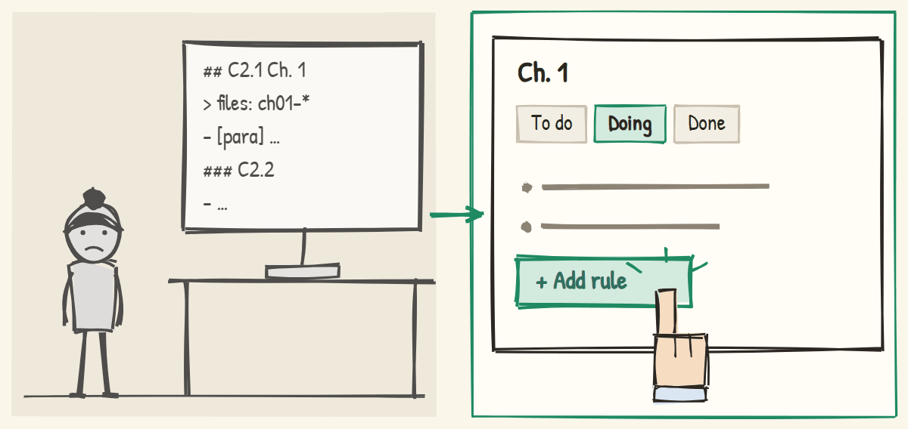<br><sub>Problem</sub><br>Hand-editing Markdown<br><sub>ReqTree</sub><br><b>Add rules, change status, undo — all by clicking</b></td>
</tr>
</table>

## Screenshots

| Sidebar (dark theme) | Mind map (light theme) |
|---|---|
|  |  |

## Getting started

**You need** Node.js 18+, VS Code, and Claude Code or OpenAI Codex.

1. Install the VS Code extension: download `reqtree-<version>.vsix` from [Releases](https://github.com/penstic123-code/Vibe-Friend/releases), then Extensions → `…` → "Install from VSIX".
2. Open your project. The extension asks whether to enable ReqTree here — click enable. (Or run "需求树：在本项目启用" from the command palette.)
3. Start a new Claude Code session and work as usual.

Prefer the command line?

```bash
npx github:penstic123-code/Vibe-Friend init <your-project>               # Claude Code
npx github:penstic123-code/Vibe-Friend init <your-project> --tool codex # OpenAI Codex
```

Enabling installs hooks in the project (Claude Code: `.claude/settings.local.json`; Codex: `.codex/hooks.json` plus a managed block in `AGENTS.md`) and creates a template `需求树.md` if there is none. The hook scripts are copied to `~/.reqtree/runtime/` and refreshed when the extension updates. For Codex details see [docs/codex.md](docs/codex.md) (in Chinese).

Day to day you don't do anything extra:
- Say "from now on, end every chapter with a reflection question", and after that turn it appears in the tree.
- When the assistant edits `ch01.html`, it automatically gets the rules of Chapter 1 and everything above it.
- The sidebar shows which requirement the assistant is editing. If the recorder got something wrong, click undo under "Recent changes".

### What the tree looks like

```markdown
# P Example course
- [para] Paragraphs at most 4 lines          ← root rules apply everywhere

## C2 Data science course 🔨
> 文件：DataScience/**                       ← the files this requirement covers
- No direct quotes; retell everything

### C2.1 Chapter 1 🔨
> 文件：DataScience/ch01-*.html
- [para] The opening may run to 6 lines      ← same key: overrides the parent in Chapter 1
- Hook the reader within the first screen
```

- A heading is a requirement: an ID first, a status last (✅ done 🔨 in progress ⏳ to do ❓ undecided).
- List items under a heading are its rules.
- A requirement without `> 文件：` (files) inherits its parent's scope; if no ancestor has one, the panel warns you.

## How it works

Everything revolves around one file. While you chat, a background recorder writes long-term requirements into `需求树.md`. The tree is compiled into one rule file per requirement, each declaring which files it covers. Claude Code's own mechanism hands those rules to the assistant when it touches matching files.

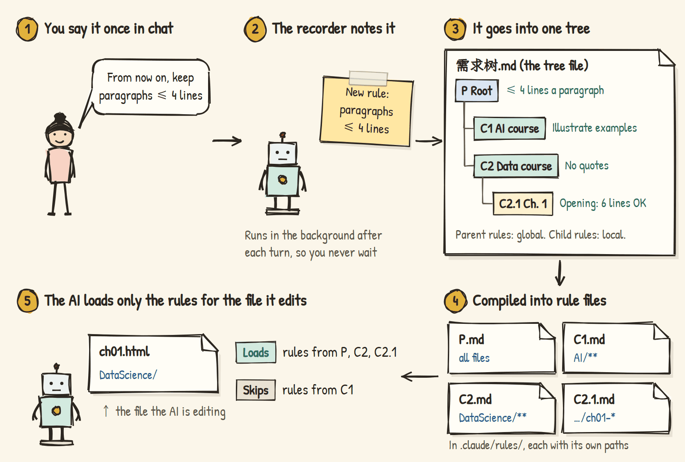

**Loading on demand.** Each requirement compiles to `.claude/rules/reqtree/<ID>.md` with a `paths:` header. These are Claude Code's native path-scoped rules: they enter the context only when the assistant reads or writes a matching file. A parent's scope contains its children's, so editing Chapter 1 brings in the root, the course and the chapter rules — and nothing from other courses.


**The recorder.** At the end of each turn, a hook starts Claude Haiku in the background. It reads only your message and the assistant's final reply. It first looks for a rule on the same topic: if there is one, it rewrites it; otherwise it adds one. One-off instructions ("shorten this paragraph") are not recorded, and short replies like "ok" or "continue" skip the model entirely. Changes apply immediately and are logged in `.reqtree/changes.jsonl` with an inverse operation, so each one can be undone.

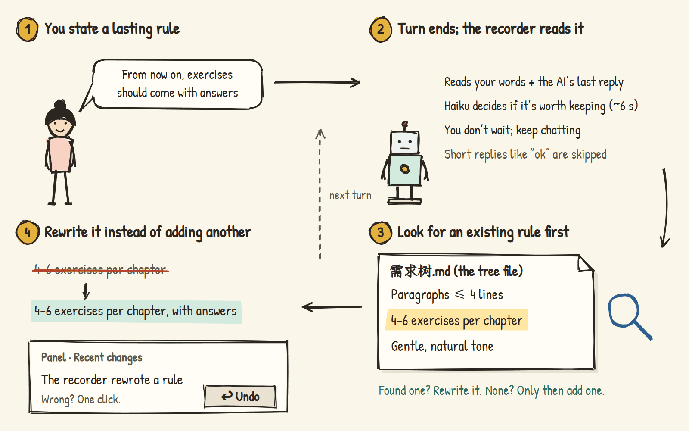

**Why not inject rules with hooks?** Early versions did. Claude Code's native rules turned out to be more reliable: they work inside subagents and after compaction, and rules created or edited mid-session are pushed to the assistant. So the hooks now only do what the native mechanism can't — track which requirement is being edited and start the recorder. They add nothing to the assistant's context.

| Part | What it does |
|---|---|
| `src/parser.js` | Parses the tree; every edit goes through `applyOps`, and each operation returns its inverse; similarity-based dedupe |
| `src/compile.js` | Compiles each requirement into a native rule file; inheritance via nested scopes, overrides written as "within this scope, this one wins" |
| `src/store.js` | Locked atomic writes, recompiles after every write, change log and undo, state files |
| `hooks/hook.js` | Keeps rules fresh when you send a message, records which requirement an edited file belongs to, starts the recorder at the end of a turn, and logs which rules were loaded |
| `hooks/recorder.js` | Uses Haiku to decide whether the turn contained a long-term requirement, then rewrites or adds a rule |
| `extension.js`, `media/` | VS Code sidebar and mind map |

## Saving context and tokens

| Feature | Status |
|---|---|
| Rules load on demand, only when matching files are touched | ✅ |
| Hooks add nothing to the conversation | ✅ |
| Old rules are rewritten instead of duplicated, so the tree doesn't keep growing | ✅ |
| The recorder uses the inexpensive Haiku model in the background; short replies skip it | ✅ |
| Context meter: which rules each session loaded, how many characters each, resident vs on demand | Logging done; panel view in progress |
| Split CLAUDE.md: move requirement-specific content into the tree so it loads on demand | Planned |
| Cross-file duplicate and contradiction check between the tree, CLAUDE.md and project docs | Planned (experiment script exists) |

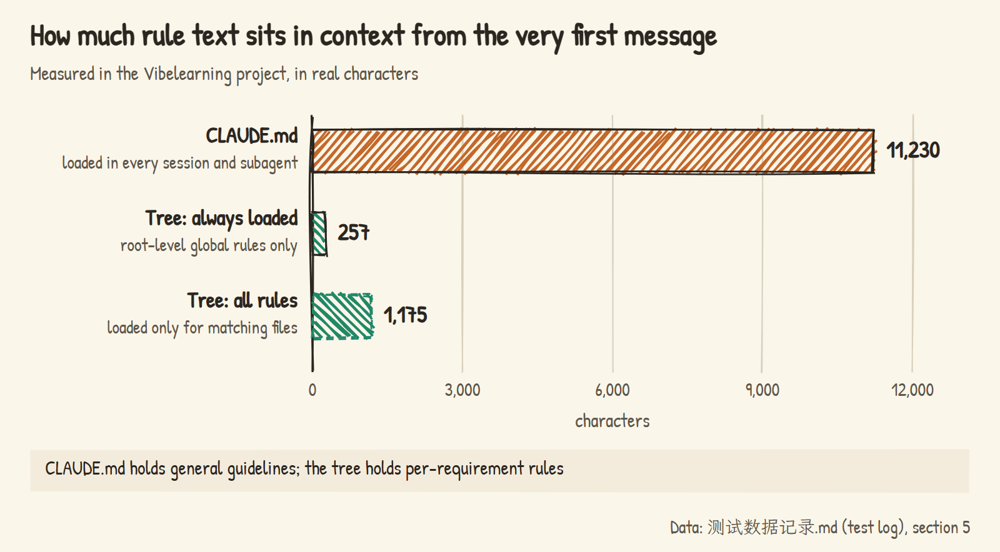

## Test data

Raw data and experiment conditions are in [`测试数据记录.md`](测试数据记录.md) (the test log, in Chinese).

**Does the recorder judge correctly?** Six kinds of situations, three runs each, with the real Haiku model: a reworded duplicate is not added, a change of mind rewrites the original rule, a genuinely new rule is added, a one-off instruction is ignored, a rejected rule is deleted, and a child repeating its parent is not added. 18 out of 18 correct.


**With or without ReqTree — do rules get messier?** A simulated 32-turn conversation in which the user gradually states 13 long-term requirements, changes their mind, cancels some and adds exceptions. Three arms: the assistant maintaining its own rule document (plain prompt, careful prompt) and the ReqTree recorder. When the assistant kept its own document, a cancelled rule turned into a new "don't …" entry that stayed behind, and some rules landed in the wrong scope; ReqTree had neither problem. All three arms missed some requirements.


**How messy is a real project?** In a real course project's 21 rule documents, most problems sit **across files**: the same rule copied in several places, updated in one and stale in the others. With ReqTree each rule has exactly one place, which removes this class of problem at the root.

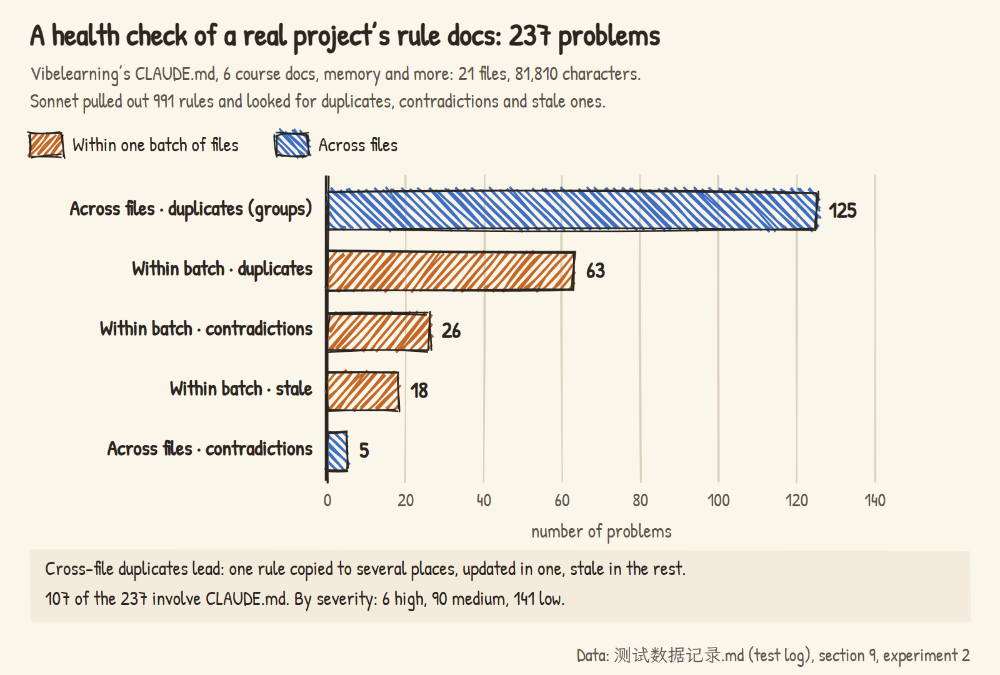

## Current limits

- Works with Claude Code and OpenAI Codex. Codex has no path-scoped rules, so ReqTree uses an index in `AGENTS.md` plus hooks that deliver the right rules (see docs/codex.md).
- The recorder sometimes misses things, especially decisions about a single chapter's content ("open Chapter 1 with this story"). You can add those by hand in the panel.
- Each turn costs one extra Haiku call, run in the background (about 6 seconds).
- The extension UI is in Chinese for now.
- Developed on Windows; macOS and Linux are covered by CI.

## Command line

```bash
node bin/reqtree.js init    <project>          # enable: install hooks, compile rules
node bin/reqtree.js tree    需求树.md           # print the whole tree
node bin/reqtree.js rules   需求树.md C2.1      # the rules in effect for one requirement
node bin/reqtree.js compile 需求树.md           # compile by hand (normally automatic)
node bin/reqtree.js check   需求树.md           # duplicate IDs, requirements without files, stale 🔨
```

**Note:** don't force-reinstall the extension from the command line (`code --install-extension --force`) while Claude Code is running in VS Code. It restarts the extension host, and Claude Code restarts with it.

## Development

```bash
node --test test/*.test.js        # all automated tests (UI tests need Edge or Chrome)
node test/eval-recorder.js 3      # evaluate the recorder with the real Haiku model (costs a little)
node test/eval-confusion.js 2     # the with/without comparison (about 200 model calls)
```

## License

MIT
