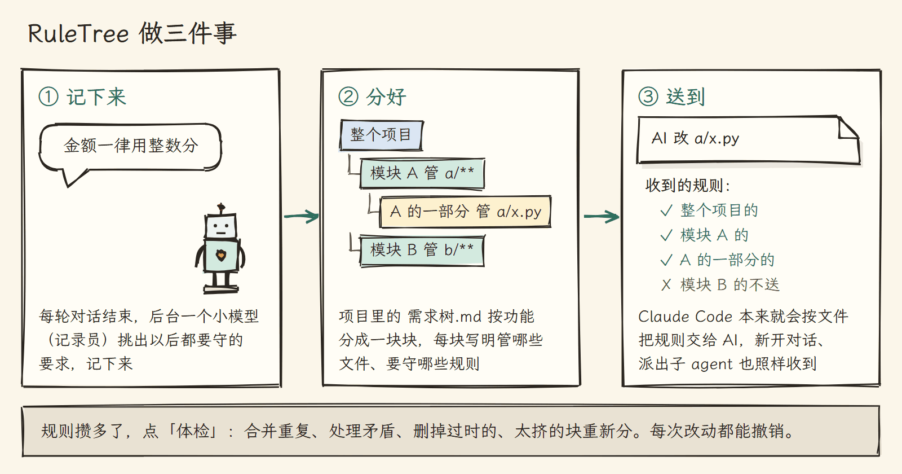

# RuleTree 需求树

一套为 AI 编程设计的信息架构：规则、文档、代码地图各归其位，一直替你理好，AI 改哪个文件，就只读哪个文件的规则。

给 [Claude Code](https://claude.com/claude-code) 和 [OpenAI Codex](https://developers.openai.com/codex) 用的 VS Code 插件。[English](README.en.md) | 中文


用 AI 写一个项目写到第三周，你已经跟它说过几十条要求：注释用中文，金额一律用整数分，改完先跑一遍测试。这些话散在聊天记录、CLAUDE.md、AI 自己的记忆和设计文档里。新开一个对话，AI 就看不到聊天里说过的话；全写进 CLAUDE.md，它改一个标点也要先读完几万字；哪天你改了主意，旧说法还留在另外两处，AI 不知道该听哪一份。


作者自己的一个项目里，21 份写着规则的文档查出 237 处重复、矛盾和过时的说法。RuleTree 把这些要求收进项目里的一个文件，按"管哪些文件"分好，AI 改哪个文件，就只把管这个文件的几条交给它：



## 信息各归其位

项目里的信息不止规则：还有设计文档、代码本身、AI 的记忆、CLAUDE.md。每类信息放在哪、AI 什么时候读到哪些，这套安排就是信息架构。安排得不好，同一件事写在几处、AI 读一大堆用不上的；安排得好，每件事只写一处，AI 干活时手上正好是它要的。

RuleTree 的安排以一个文件为中心：项目里的 `需求树.md`。它把项目按功能分成一块块，每一块叫一个需求，大块下面还可以分小块。每个需求写明两件事：它管哪些文件，改这些文件时要守哪些规则。规则就是一句话能照着做的要求。拿一个网店举例：

```markdown
# P 网店
- 注释用中文

## R1 支付
> 文件：src/payment/**
> 文档：docs/payment-design.md
- 金额一律用整数分

### R1.1 退款
> 文件：src/payment/refund.ts
- 退款前先查订单状态
- 决定：退款走消息队列，不直接调支付接口（失败了能重试）
```

`#` 的个数就是树的层数，P、R1、R1.1 是编号。`> 文件：` 写这个需求管哪些文件，`> 文档：` 写改这块之前该读的设计文档，`-` 开头的每一行是一条规则。以"决定："开头的规则，是你在几种做法里拍板选定的，AI 想推翻它要先问你。

规则之外的信息，各有各的位置：

| 什么信息 | 放在哪 | AI 什么时候读 |
|---|---|---|
| 一句话能照着做的要求，如"金额一律用整数分" | 需求树里，挂在管相关文件的需求下 | 改到这些文件时自动收到 |
| 你拍板选定的做法和理由 | 同上，开头写"决定：" | 同上；想推翻要先问你 |
| 一句话说不清的：为什么这样设计、怎么做、例子 | 设计文档，需求树里用 `> 文档：` 指向它 | 改到这些文件时先收到文档的目录，只读用得上的几节 |
| 每块代码已有哪些文件、函数和类 | 代码地图，RuleTree 读代码自动生成 | AI 写新功能前想查就去读，免得重写一份 |
| 和项目无关的事，如你的电脑环境 | AI 自己的记忆 | Claude Code 自己管 |
| 项目是什么、东西放在哪 | CLAUDE.md | 每次都读，所以越短越好 |

## AI 改文件时收到什么

AI 改 `src/payment/refund.ts` 时，管这个文件的有三层：整个网店、支付、退款。这三层的规则交给 AI，登录、商品页、优惠券的规则不送。


送规则靠的是 Claude Code 自带的一个功能：放在 `.claude/rules/` 里的规则文件可以写明"只在读写某些文件时加载"。RuleTree 把每个需求编成一份这样的文件，送规则就不靠 AI 的记性，新开对话、对话太长被压缩、派出子 agent，都照样送到。Codex 没有这个功能，RuleTree 改用一份目录加补送，见 [docs/codex.md](docs/codex.md)。

小块也可以改写大块的某条规则，只在自己管的文件里算数。比如整个网店规定"函数不超过 40 行"，支付那块写"支付函数可以到 80 行"，AI 改别的文件时仍然按 40 行。

## 记录员：每轮自动记下

需求树不用你自己写。每轮对话结束，一个便宜的小模型（Claude 的 Haiku）在后台读你这一轮说的话，挑出以后都要守的要求，记到管相关文件的需求下。这个后台小模型叫记录员，跑一次约 6 秒，你不用等它。


你改了主意，它改写原来那条，不另加一条。你在几个方案里选定一个，它记成"决定："。AI 干活时你中途插的几句话，也都交给它读。拿不准该不该记、记在哪一块时，它先按最可能的记下，再弹出来问你，你选别的它就换过来；不想被问，可以在设置里关掉。每次改动都列在侧栏的"最近改动"里，记错了点"撤销"。

## 体检：规则攒多了自己理

用上几周，需求树会长歪：同一件事记了两遍，前后说法打架，规则里提到的文件已经删了，某一块挂了四十条规则。这时点侧栏的"体检"按钮。

RuleTree 先用程序找出可疑的地方：改同一个文件会一起收到的两条相似规则，规则里提到、项目里却已经找不到的文件和类名，规则太多的需求。再让模型逐个判断：重复的合并，打架的以后定的为准，过时的删掉，太挤的需求重新分成几个小需求，再把每条规则原文挂回去。散在 CLAUDE.md、设计文档和 AI 记忆里的要求，也一起搬进需求树。

整理得好不好，要有个数才能比。所以体检报告最后会给需求树打一个分，满分 100，是下面六项的平均：

| 看什么 | 为什么要看 |
|---|---|
| 送得到：有没有规则挂在不管任何文件的需求上 | 这种规则永远不会送到 AI 手上 |
| 不挤：有多少需求自己挂了 12 条以上规则 | 挂太多说明该拆成小块 |
| 顶上少：最顶上那块挂了几条规则 | 顶上的规则改任何文件都送 |
| 读得少：改一个文件时 AI 平均收到多少字 | 收到的越少，越不占 AI 的上下文 |
| 不重叠：有没有文件同时归两块管 | 归两块管，两套规则都送 |
| 代码挂对：有没有文件挂在甲块，却几乎只被乙块用 | 挂错了，改它的 AI 收到的是不相干的规则 |

作者在两个真实项目的副本上各整理了 3 次。项目 A 是一个游戏，几百个代码文件，需求树里有三百多条规则；项目 B 是一个教学网站，有六门网页课程：


项目 A 最顶上的规则从 57 条减到 33 条，改一个文件收到的规则从 74 条减到 55 条，评分从 62 升到 81。三次整理都没有丢规则，也没有改动规则的原文。

规则写着，AI 也会疏忽。体检时，模型还从规则里挑出看一行代码就能判断的（比如"不留调试输出"），写成自动检查。之后 AI 每改完一个文件，RuleTree 就查它刚写的那几行，可能违反就当场提醒它。


## 界面

| 侧栏（深色主题） | 导图（浅色主题） |
|---|---|
|  |  |

| AI 正在改哪个需求，那一行会亮 | 这个对话读了哪些规则、各多少字 |
|---|---|
|  |  |

## 怎么装

需要 Node.js 18 以上、VS Code，以及 Claude Code 或 OpenAI Codex。最省事的是在项目里开一个 Claude Code 或 Codex 对话，把这段话发给它：

```text
帮我在这个项目里装上 RuleTree（https://github.com/penstic123-code/Rule-tree）：
1. 运行 npx github:penstic123-code/Rule-tree init .（如果你是 Codex，在末尾加 --tool codex）
2. 从 https://github.com/penstic123-code/Rule-tree/releases/latest 下载最新的 reqtree-*.vsix，放到项目文件夹外面，告诉我放在哪
3. 不要自己运行 code --install-extension，告诉我怎么在 VS Code 里从 VSIX 安装它
```

插件要你自己装：VS Code 扩展面板 → `…` → "从 VSIX 安装"。用命令行装会把正在跑的 AI 对话一起重启。装好后打开项目，点"启用"，插件会让 AI 读一遍项目，一两分钟生成第一棵需求树，新开一个对话就能用。Codex 的用法见 [docs/codex.md](docs/codex.md)。

## 实测数据

实验都用真实模型，在作者两个真实项目的副本上跑，就是上面的项目 A（游戏）和项目 B（教学网站）。

### 装了 RuleTree，AI 读得少了，规则守得更好吗？

规则按文件送，AI 要读的东西应该变少；读得少、读得准，违反的规则也许会少。为了验证，两个项目各出 2 个小任务，比如给项目 A 加一个营业时间提示、给项目 B 的一章加小结。同一批规则分三种放法：全写进 CLAUDE.md；装 RuleTree；装 RuleTree 再把整份代码地图交给 AI。每种放法让 AI 真改 8 次，另一个模型逐条对照规则，数每次改动违反了几条。


AI 要读的规则和说明少了四到六成，违反的规则却没有变少：项目 A 上三种放法都接近 0，项目 B 上都是每次约 1 条。也就是说，在改一个文件就结束的短任务上，RuleTree 让 AI 读得少，还没让它更守规则；长对话里会怎样还没测。整份代码地图没看出用处，所以现在改成 AI 想查才去读。

### 真实对话里说的要求，记对了吗？

作者 12 个真实对话里亲手打的消息，按时间顺序重放给记录员，再让一个更强的模型列出这些对话里该记下的规则，当标准答案对照。旧版记录员有个毛病：在做某一块时顺口说的通用要求（比如"先给结论再解释"），常被挂到当时在做的那一块下面，AI 改别处时就收不到。现在改成按规则管的文件来挂：


挂错和记错都大幅减少，漏记却多了。之后查到一个原因：记录员把"在几个方案里选定一个""对产出的批评"当成一次性的话，不记。提示词已经改了，还没重测。

### 和让 AI 自己维护规则文档比呢？

模拟一段 32 轮的对话：用户陆续提 13 条长期要求，中途改主意、取消、加例外，最后看记下的规则对不对。AI 自己记的时候，用户说"思考题取消吧"，它常常另写一条"不设思考题"，旧的那条还留着；RuleTree 直接删掉被取消的那条。


### 重新整理会不会丢规则、改错规则？

两个项目各整理 3 次，规则一条没丢，原文没改，"决定："一条不少。另外在副本里故意埋了三处错，看体检能不能找出来。最顶上一条只管代码的规则，6 次都被挪到了"代码规范"那一块下面，还做成了自动检查。一条要 AI 去用一个已经不存在的类的规则，8 次都被判为过时删掉。两份说法矛盾的设计文档，项目 B 3 次都查出来了；项目 A 文档多，一次也没查出，之后改了比对的方式，还没重测。

## 和别的办法比

| 办法 | 能做到 | 做不到 |
|---|---|---|
| 把规则都写进 CLAUDE.md | 每次开工都读到 | 改什么都整份读，越写越长；要你自己维护 |
| AI 的自动记忆 | 自动记下一些话 | 不知道一条规则属于哪块功能，越记越乱 |
| 自己写规则文档 | 想写多细写多细 | 要你自己改；AI 不知道该在什么时候读哪份 |
| [graphify](https://github.com/safishamsi/graphify)、[aider 的 repo map](https://aider.chat/docs/repomap.html) | 帮 AI 看懂代码结构，比 RuleTree 的代码地图强 | 不管你的要求和规则；不支持 GDScript |
| RuleTree | 自动记下要求，按功能分好，改到哪送到哪；自己整理，自己打分 | 记录员会漏记、挂错，要你改或撤销；还没证明能让 AI 更守规则 |

## 常见问题

<details>
<summary>AI 不是本来就记得我说过的话吗？</summary>

同一个对话里记得。新开对话、对话太长被压缩、派出子 agent 之后就看不到了。RuleTree 把规则存在文件里，AI 改到相关文件时送到它面前。
</details>

<details>
<summary>项目有上千个文件，AI 怎么知道哪条规则在哪？</summary>

AI 不用找。每个需求写明了管哪些文件，Claude Code 在 AI 读写某个文件时，自动把管这个文件的规则交给它。
</details>

<details>
<summary>会不会很慢、会不会老来问我？</summary>

记录员每轮在后台跑一次，约 6 秒，不耽误你；体检大项目要几分钟。拿不准时它先按最可能的记下，再问你一句，你不回答也不耽误干活；嫌烦可以在设置里关掉，只在要推翻你的"决定"时才问。
</details>

<details>
<summary>装了 RuleTree，AI 就会更守规则吗？</summary>

目前没测出来。测出来的是 AI 要读的东西少了四到六成，规则不再散在几处各说各的。为此加了改完马上查。
</details>

## 目前的限制

- 还没证明能让 AI 更守规则。
- 规则按文件送。所有内容都塞在一个文件里的项目，没法只送一部分。
- 记录员靠小模型判断，回放真实对话时约两成规则漏记、约 5% 记错，要你在面板上改或撤销。
- 设计文档之间说法打架，只比得出同一块功能里的。
- 代码地图用正则表达式读代码，冷门语言可能认不全。
- Codex 没有按文件加载规则的功能，改用目录加补送。
- 在 Windows 上开发；Mac 和 Linux 由自动测试覆盖。

## 给开发者

设计说明见 [docs/architecture.md](docs/architecture.md) 和 [docs/design-info-architecture.md](docs/design-info-architecture.md)，每次实验的条件和逐次结果见 [docs/test-log.md](docs/test-log.md)。

```bash
node --test test/*.test.js             # 全部自动测试
node bin/reqtree.js                    # 命令行用法
node bin/reqtree.js health 需求树.md   # 给一棵树打分
```

配图源码在 `docs/images/src/`。不要在用着 Claude Code 时用命令行强制重装插件，那会把 Claude Code 一起重启。

## 许可

MIT
