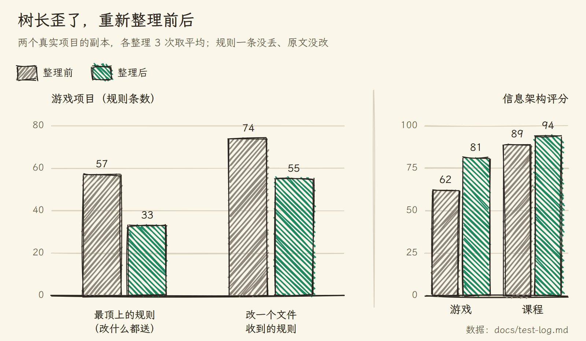
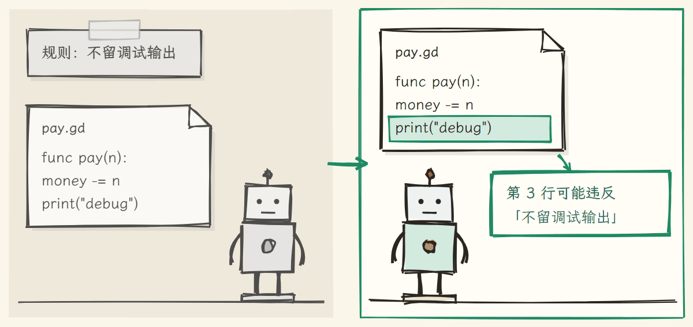

# RuleTree 需求树

一套为 AI 编程设计的信息架构：规则、文档、代码地图各归其位，一直替你理好，AI 改哪个文件，就只读哪个文件的规则。

给 [Claude Code](https://claude.com/claude-code) 和 [OpenAI Codex](https://developers.openai.com/codex) 用的 VS Code 插件。[English](README.en.md) | 中文


你在对话里说的长期要求，每轮结束后由一个后台小模型（Haiku）记进项目里的 `需求树.md`，挂在管那些文件的需求下。需求树编译成 Claude Code 自带的路径规则，AI 读写哪个文件，Claude Code 就把管这个文件的规则交给它，新开对话、对话被压缩、派出子 agent 都一样。规则多了，点一下"体检"，它合并重复、处理矛盾、重新整理结构，并给信息架构打分。


## 你是不是也遇到过

1. 同一条规则在聊天、CLAUDE.md、AI 的记忆、模块文档里各写一遍，后来只改了一处。作者的一个项目查出 21 份规则文档里有 237 处重复、矛盾和过时。
2. 规则越攒越多，结构却一直是最初的样子。作者的游戏项目里，一个需求挂了 41 条规则，AI 改一个路灯脚本，也收到店铺摆设的规定。
3. CLAUDE.md 和设计文档几万字，AI 改个标点也从头读到尾。
4. 改支付模块时说的要求被用到别的模块；新开一个对话，之前说的就没了。
5. 规则写着，AI 还是照犯，你也不知道这些办法到底有没有用。


## 信息各归其位

| 放在哪 | 放什么 | AI 什么时候读 |
|---|---|---|
| 规则（需求树里） | 一句话就能照着做的要求，如"金额一律用整数分" | 改到对应文件时自动送到 |
| 决定（"决定："开头的规则） | 你选定的做法和理由 | 同上；AI 想推翻得先问你 |
| 文档（挂在需求上） | 规则装不下的：为什么、怎么做、例子、进度 | 改到对应文件时先看目录，只读需要的那几节 |
| 代码地图（自动生成） | 这块代码已有哪些文件、函数和类 | AI 写新功能前想知道就去读 |
| AI 的自动记忆 | 和项目内容无关的事，如你的电脑环境 | Claude Code 自己管 |
| CLAUDE.md | 项目入口：是什么项目、东西在哪 | 每次都读，所以越短越好 |

同一件事只写一处：能照着做的进需求树，要解释的进文档。每个需求写明管哪些文件，AI 改一个文件，只收到从整个项目到这个文件那一路上的规则。


## 它自己把信息架构理好

信息一直在进来，光定好位置不够。需求树会自己维护这套结构：新规则按它管的文件挂到对应需求下，文档和 AI 记忆里写着的规则搬进树，重复的合并，打架的以后说的为准，过时的清掉。某个需求挂的规则太多、最顶上堆得太多，就让 AI 重新分需求和子需求，再把每条规则原文挂回管它的那一层。在作者两个项目的副本上整理 3 次，规则一条没丢、原文一个字没改：



## 界面

| 侧栏（深色主题） | 导图（浅色主题） |
|---|---|
|  |  |

| AI 正在改哪个需求，那一行会亮 | 这个对话读了哪些规则、各多少字 |
|---|---|
|  |  |

## 怎么装

需要 Node.js 18 以上、VS Code，以及 Claude Code 或 OpenAI Codex。最省事的是在项目里开一个 Claude Code 或 Codex 对话，把这段话发给它：

```text
帮我在这个项目里装上需求树（https://github.com/penstic123-code/Vibe-Friend）：
1. 运行 npx github:penstic123-code/Vibe-Friend init .（如果你是 Codex，在末尾加 --tool codex）
2. 从 https://github.com/penstic123-code/Vibe-Friend/releases/latest 下载最新的 reqtree-*.vsix，放到项目文件夹外面，告诉我放在哪
3. 不要自己运行 code --install-extension，告诉我怎么在 VS Code 里从 VSIX 安装它
```

插件要你自己装：在 VS Code 扩展面板 → `…` → "从 VSIX 安装"。用命令行装会把正在跑的 AI 对话一起重启。装好后打开项目，点"启用"，插件会让 AI 读一遍项目，一两分钟生成第一棵需求树；新开一个对话就能用。所有改动都能在"最近改动"里一键退回。Codex 的用法见 [docs/codex.md](docs/codex.md)。

## 怎么工作的

### 改到哪个文件，送哪条路上的规则

AI 只看得到它的上下文，新开对话、对话被压缩、派出子 agent，之前说的就不在了；规则全写进 CLAUDE.md，又是改什么都整份读。需求树把规则存在文件里，按文件送到：


```markdown
# P 小镇游戏
- 注释用中文                         ← 改任何文件都要守

## R3 店铺
> 文件：game/shops/**                 ← 这个需求管哪些文件
> 文档：docs/shop-design.md           ← 改这块前先读的文档
- 店员只在店里出现

### R3.1 店门与营业时间
> 文件：game/shops/shop_door.gd
- 营业时间只从 ShopHours 取
```

AI 改 `shop_door.gd` 时，收到的是这三层：整个项目的、店铺的、店门的；别的模块的一条都不来。下一级可以改写上一级的某条规则，只在自己的范围里算数：


一个有六门网页课程的项目，规则挂进需求树后，做一章时 AI 要读的少了三到五成：


### 长文档只给目录

挂在需求上的长文档不整份送，只送一行：这份文档讲什么、多少字、每一节在第几行。AI 先看目录，只读用得到的那几行；也可以只挂文档的某一节，如 `> 文档：docs/shop-design.md#营业时间`。

### 后台记录，在原条目上改

每轮聊完，记录员读这一轮的对话，判断哪些是以后都要遵守的。你改了主意，它改写原来那条，不另加一条；拿不准管多大范围时，挂在你正在做的需求上。每次改动都记在"最近改动"里，记错了点"撤销"。


### 体检：理重复、矛盾、过时和结构

点"体检"，程序先找出证据：哪些规则会在同一个文件上一起送到、哪些提到的文件或类名已经不存在、哪些需求挂得太多。模型只判断这些候选：是重复、矛盾还是有意的例外，是不是真的过时。参考的是哪个需求正在做、你哪天定下的哪条规则，后定下的为准。有把握的直接改，拿不准的不动，只有要推翻你的"决定"才问你。

### 改完马上查

规则写着 AI 也会疏忽。体检时，模型挑出看一行就能判断违没违反的规则（不留调试输出、不用某个说法），写成检查；之后 AI 每改完一个文件，就查它刚写的那几行，可能违反就提醒它。



### 给信息架构打分

每次体检的报告最后都有一个分数，前后能比。下面是作者的游戏项目重新整理后的报告：

```text
总分 82（送得到 100 · 不过载 79 · 根精简 48 · 上下文 70 · 不重叠 99 · 代码归属 98）
结构：47 个需求、最深 2 层、332 条规则；根上 31 条（改任何文件都会送）；8 个需求自己挂了 12 条以上
改一个文件时送到的：平均 49.4 条规则，平均 7611 字
最近 30 天：记录员记了 24 条，被你撤销 0 次、在面板上改掉删掉 1 条
```

六项分别看：有没有规则永远送不到、有没有需求挂得太多、最顶上堆了多少、改一个文件收到多少字、需求的范围有没有重叠、代码有没有挂错地方。

## 实测数据

下面的实验都在作者两个真实项目的副本上用真实模型跑：一个 Godot 游戏，一个有六门网页课程的项目。

### 装了需求树，AI 读的少了，规则守得更好了吗？

让 AI 真改文件：给课程章节加小结、加练习，给游戏加营业时间提示、加外卖小费。同样的规则，一组全写进 CLAUDE.md，一组装需求树，一组再加代码地图，每组改 16 次，另一个模型逐条判断改动违反了几条。


要读的规则和说明少了四到六成；违反的规则没有变少，课程项目上几组都是每次约 1 条，游戏项目上都接近 0。这些都是改一个文件就结束的短任务，长对话里会怎样还没测。代码地图整份送给 AI 时没看出用处，所以现在改成 AI 想看才读。

### 真实对话里说的规则，记对了吗？

把作者几周里 12 个对话中亲手打的消息，按时间顺序交给记录员重放，再让另一个模型对照"现在应该生效的规则"打分。旧版的毛病是在做某门课时说的通用要求，常被挂到那门课下面；现在按规则管的文件来挂：


挂错基本解决了，漏记却多了，这是下一步要改的。

### 和让 AI 自己维护规则文档比呢？

模拟一段 32 轮的对话：用户提 13 条长期要求，中途改主意、取消、加例外。AI 自己记的时候，你说"思考题取消吧"，它常常再写一条"不设思考题"，旧的那条还留着；需求树直接删掉被取消的那条。


### 重新整理会不会丢规则、改错规则？

两个项目各整理 3 次：规则一条没丢、原文没改，"决定"一条不少。在副本里故意埋了三处错，体检找出了其中两类：根上一条只管代码的规则被挪到"代码规范"下并做成了检查（6 次全对）；一条要 AI 去用一个不存在的类的规则被判为过时删掉（8 次全对）。两份说法矛盾的文档，文档少的课程项目 3 次都查出来了，文档多的游戏项目一次没查出，之后改了比对方式，还没重测。

原始数据和每个实验的细节在 [docs/test-log.md](docs/test-log.md)。

## 和别的办法比

| 办法 | 能做到 | 做不到 |
|---|---|---|
| 把规则都写进 CLAUDE.md | 每次开工都读到 | 改什么都整份读，越写越长；要你自己维护 |
| AI 的自动记忆 | 自动记下一些话 | 不知道一条规则属于哪个模块，越记越乱 |
| 自己写规则文档 | 想写多细写多细 | 要你自己改；AI 不知道该在什么时候读哪份 |
| [graphify](https://github.com/safishamsi/graphify)、[aider 的 repo map](https://aider.chat/docs/repomap.html) | 帮 AI 看懂代码结构，比需求树的代码地图强 | 不管你的要求和规则；不支持 GDScript |
| 需求树 | 自动记下要求，按模块分好，改到哪送到哪；自己整理，自己打分 | 记录员会漏记、挂错，要你改或撤销；还没证明能让 AI 更守规矩 |

## 常见问题

<details>
<summary>AI 不是本来就记得我说过的话吗？</summary>

同一个对话里记得。新开对话、对话被压缩、派出子 agent 之后就看不到了。需求树把规则存在文件里，到时候送到它面前。
</details>

<details>
<summary>项目有上千个文件，AI 怎么知道哪条规则在哪？</summary>

AI 不用找。规则编进 Claude Code 自带的"按路径加载"：AI 读写哪个文件，Claude Code 就把管这个文件的规则交给它。
</details>

<details>
<summary>会不会很慢、会不会老来问我？</summary>

记录员每轮在后台跑一次，约 6 秒，不耽误你；体检大项目要几分钟。拿不准的它按最可能的意思记下、或者不改，只有你的新说法要推翻一条"决定"时才问你。
</details>

<details>
<summary>装了需求树，AI 就会更守规矩吗？</summary>

目前没测出来。确定的是 AI 读的东西少了四到六成，规则不再散在几处各说各的。所以才加了"改完马上查"。
</details>

## 目前的限制

- 还没证明能让 AI 更守规矩。
- 规则按文件送。所有内容都塞在一个文件里的项目，没法只送一部分。
- 记录员靠小模型判断，回放真实对话时约两成规则漏记、约 5% 记错，要你在面板上改或撤销。
- 文档之间说法打架，只比得出同一块内容里的。
- 代码地图用正则读代码，冷门语言可能认不全。
- Codex 没有按文件送规则的机制，改用索引加补送。
- 在 Windows 上开发；Mac 和 Linux 由自动测试覆盖。

## 给开发者

设计说明见 [docs/architecture.md](docs/architecture.md) 和 [docs/design-info-architecture.md](docs/design-info-architecture.md)。

```bash
node --test test/*.test.js             # 全部自动测试
node bin/reqtree.js                    # 命令行用法
node bin/reqtree.js health 需求树.md   # 给一棵树打分
```

配图源码在 `docs/images/src/`。不要在用着 Claude Code 时用命令行强制重装插件，那会把 Claude Code 一起重启。

## 许可

MIT
