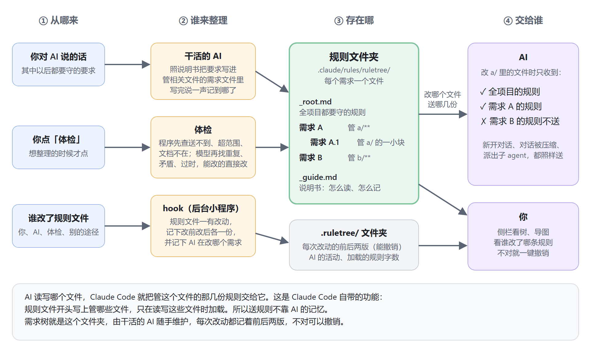
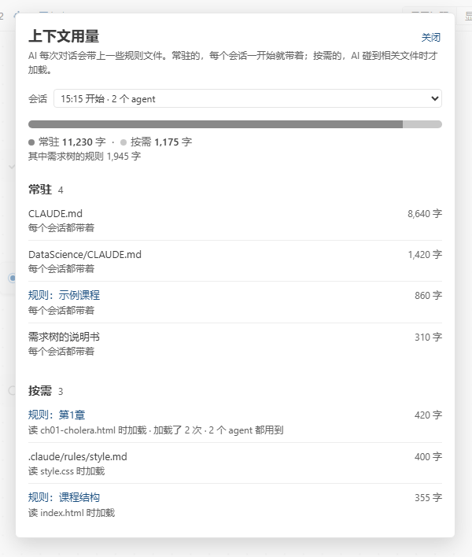
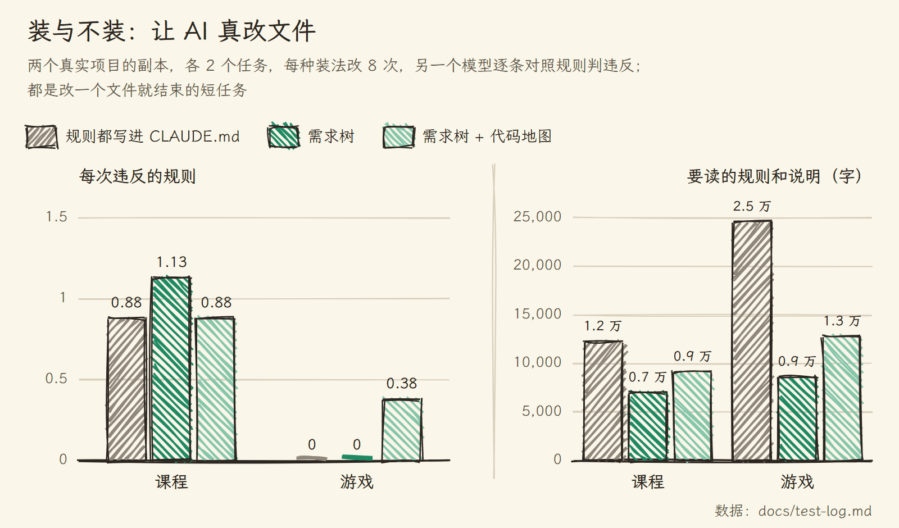

# RuleTree 需求树

一套为 AI 编程设计的信息架构：每个需求一份规则文件，AI 改哪个文件，就只读管这个文件的那几份；谁改了哪条都记着，一键撤销。

给 [Claude Code](https://claude.com/claude-code) 用的 VS Code 插件。[English](README.en.md) | 中文



技术上只做三件事：把每个需求写成一个规则文件，开头标明它管哪些文件；AI 读写哪个文件，Claude Code 自带的路径规则功能就只把管这个文件的那几份交给它；插件记下每次改动的前后两版，让你随时撤销。

用 AI 写一个项目写到第三周，你已经跟它说过几十条要求：注释用中文，金额一律用整数分，改完先跑一遍测试。这些话散在聊天记录、CLAUDE.md、AI 自己的记忆和设计文档里。新开一个对话，AI 就看不到聊天里说过的话；全写进 CLAUDE.md，它改一个标点也要先读完几万字；哪天你改了主意，旧说法还留在另外两处，AI 不知道该听哪一份。


作者自己的一个项目里，21 份写着规则的文档查出 237 处重复、矛盾和过时的说法。RuleTree 把这些要求收进项目里的一个文件夹，每个需求一个文件，写明它管哪些文件。AI 改哪个文件，Claude Code 就只把管这个文件的那几份交给它。

## 信息各归其位

项目里的信息不止规则：还有设计文档、代码本身、AI 的记忆、CLAUDE.md。每类信息放在哪、AI 什么时候读到哪些，这套安排就是信息架构。安排得不好，同一件事写在几处、AI 读一大堆用不上的；安排得好，每件事只写一处，AI 干活时手上正好是它要的。

RuleTree 的安排以项目里的 `.claude/rules/ruletree/` 文件夹为中心。它把项目按功能分成一块块，每一块叫一个需求，大块下面还可以分小块，每个需求是一个文件。拿一个网店举例，退款这一块的文件叫 `R1.1-退款.md`：

```markdown
---
paths:
  - "src/payment/refund.ts"
---
# R1.1 退款 🔨
上级：R1 支付
文档：docs/payment-design.md#退款
- 退款前先查订单状态
- 决定：退款走消息队列，不直接调支付接口（失败了能重试）
```

开头的 `paths:` 写这个需求管哪些文件，标题行是编号、名字和状态，`文档：` 指向改这块之前该读的设计文档，`-` 开头的每一行是一条规则。层级看编号：R1.1 是 R1 的下级，R1 管整个 `src/payment/`，最上面还有一个 `_root.md`，放全项目都要守的规则。以「决定：」开头的规则，是你在几种做法里拍板选定的，AI 想推翻它要先问你。

规则之外的信息，各有各的位置：

| 什么信息 | 放在哪 | AI 什么时候读 |
|---|---|---|
| 一句话能照着做的要求，如「金额一律用整数分」 | 管相关文件的那个需求的文件里 | 改到这些文件时自动收到 |
| 你拍板选定的做法和理由 | 同上，开头写「决定：」 | 同上；想推翻要先问你 |
| 一句话说不清的：为什么这样设计、怎么做、例子 | 设计文档，需求文件里用 `文档：` 指向它 | 改到这些文件时先读，长文档只读用得上的那节 |
| 和项目无关的事，如你的电脑环境 | AI 自己的记忆 | Claude Code 自己管 |
| 项目是什么、东西放在哪 | CLAUDE.md | 每次都读，所以越短越好 |

这些规则文件就是 Claude Code 自己认的规则文件，提交进 git 以后，队友和 git worktree 里都有同一棵树。

## AI 改文件时收到什么

AI 改 `src/payment/refund.ts` 时，管这个文件的有三层：整个网店、支付、退款。这三份规则交给 AI，登录、商品页、优惠券的规则不送。


送规则靠的是 Claude Code 自带的路径规则：`.claude/rules/` 里的规则文件开头写了 `paths:`，就只在 AI 读写这些文件时加载。送规则不靠 AI 的记性，新开对话、对话太长被压缩、派出子 agent，都照样送到。

小块也可以改写大块的某条规则，只在自己管的文件里算数。比如整个网店规定「函数不超过 40 行」，支付那块写「支付函数可以到 80 行（在本范围内取代 P 的「函数不超过 40 行」）」，AI 改别的文件时仍然按 40 行。

## 规则由干活的 AI 自己记

文件夹里有一份 `_guide.md`，是 RuleTree 写给 AI 的说明书，每个对话都会加载。它告诉 AI：你提出以后都要守的要求，或者在几个做法里拍了板，就在这一轮结束前写进对应需求的文件里。正在改的文件属于哪个需求，就写进哪个；你明说全项目的，才写进 `_root.md`；改了主意就改原来那条，不另加一条；写完在回复里说一句「已记到 R1.1」。

AI 手上本来就加载着它正在改的那个需求的文件，所以它知道规则该记在哪。RuleTree 的 hook 在后台看着：AI 每改一次规则文件，就记一条改动，列在侧栏的「最近改动」里，记错了点「撤销」。撤销只撤那一次，之后在同一个文件里加的规则留着。

## 体检：规则攒多了自己理

用上几周，需求树会长歪：同一件事记了两遍，前后说法打架，规则里提到的文件已经删了，某一块挂了四十条规则。这时点侧栏的「体检」按钮。

RuleTree 先用程序查一遍：哪些需求管的文件一个也找不到（规则永远送不到），哪些需求没写管哪些文件（规则每次都加载），下级的范围有没有超出上级，挂的文档在不在，哪个需求规则太多。意思完全一样的两条，直接删掉一条。然后调用一次模型，找出重复、矛盾和过时的规则：能改的直接改，以后定的为准；碰到「决定：」开头的不动，写进报告让你定。所有改动记成一条，能一键撤销。规则自上次体检之后一条没变，就不再调用模型。

## 界面

| 侧栏（深色主题） | 导图（浅色主题） |
|---|---|
|  |  |

| AI 正在改哪个需求，那一行会亮 | 这个对话读了哪些规则、各多少字 |
|---|---|
|  |  |

侧栏里可以改名、改状态、加规则、改文件范围，都写回对应的规则文件；也可以直接在编辑器里打开规则文件改，保存后同样记进「最近改动」。

## 怎么装

需要 Node.js 18 以上、VS Code 和 Claude Code。最省事的是在项目里开一个 Claude Code 对话，把这段话发给它：

```text
帮我在这个项目里装上 RuleTree（https://github.com/penstic123-code/Rule-tree）：
1. 运行 npx github:penstic123-code/Rule-tree init .
2. 从 https://github.com/penstic123-code/Rule-tree/releases/latest 下载最新的 ruletree-*.vsix，放到项目文件夹外面，告诉我放在哪
3. 不要自己运行 code --install-extension，告诉我怎么在 VS Code 里从 VSIX 安装它
```

插件要你自己装：VS Code 扩展面板 → `…` → 「从 VSIX 安装」。用命令行装会把正在跑的 AI 对话一起重启。装好后打开项目，点「启用」，RuleTree 按项目最上一层的文件夹建好第一批需求，新开一个对话就能用。以前用过旧版（项目里有 `需求树.md`）的，打开项目时会自动拆成规则文件，原文件留在 `.ruletree/legacy/`；旧版插件（reqtree）要先卸载。

## 实测数据

实验都用真实模型，在作者两个真实项目的副本上跑。项目 A 是一个游戏，几百个代码文件，三百多条规则；项目 B 是一个教学网站，有六门网页课程。

### 规则按文件送，AI 读得少了，规则守得更好吗？

规则按文件送，AI 要读的东西应该变少；读得少、读得准，违反的规则也许会少。为了验证，两个项目各出 2 个小任务，比如给项目 A 加一个营业时间提示、给项目 B 的一章加小结。同一批规则分两种放法：全写进 CLAUDE.md；按文件送。每种放法让 AI 真改 8 次，另一个模型逐条对照规则，数每次改动违反了几条。



AI 要读的规则和说明少了四到六成，违反的规则却没有变少：项目 A 上两种放法都接近 0，项目 B 上都是每次约 1 条。在改一个文件就结束的短任务上，按文件送让 AI 读得少，还没让它更守规则；长对话里会怎样还没测。

### 为什么不再用后台的记录员

旧版每轮对话结束，由一个便宜的小模型在后台读对话、往树里记规则。把作者 12 个真实对话按时间顺序重放给它，再让更强的模型列出该记的规则对照：约两成没记下，还会把规则挂到不管相关文件的需求上，把用户随口的提问记成要求，每轮多跑 8 到 15 秒。干活的 AI 手上已经有它在改的需求的文件，由它来记更直接。改成这样之后，AI 记得准不准还没测。

## 和别的办法比

| 办法 | 能做到 | 做不到 |
|---|---|---|
| 把规则都写进 CLAUDE.md | 每次开工都读到 | 改什么都整份读，越写越长 |
| AI 的自动记忆 | 自动记下一些话 | 不知道一条规则属于哪块功能，越记越乱 |
| 自己在 `.claude/rules/` 里写规则 | 和 RuleTree 用的是同一个机制 | 没有树和导图，看不出哪些规则管哪里；改错了没处撤销；没人提醒 AI 往哪记 |
| RuleTree | 按功能分好，改到哪送到哪；AI 照说明书记规则，每次改动能撤销；体检理重复和矛盾 | AI 也会漏记、记错，要你改或撤销；还没证明能让 AI 更守规则 |

## 常见问题

<details>
<summary>AI 不是本来就记得我说过的话吗？</summary>

同一个对话里记得。新开对话、对话太长被压缩、派出子 agent 之后就看不到了。RuleTree 把规则存在文件里，AI 改到相关文件时送到它面前。
</details>

<details>
<summary>项目有上千个文件，AI 怎么知道哪条规则在哪？</summary>

AI 不用找。每个需求写明了管哪些文件，Claude Code 在 AI 读写某个文件时，自动把管这个文件的规则交给它。还没动手、只是在讨论某个需求时，说明书让 AI 先去读那个需求的文件，文件名里就有需求的名字。
</details>

<details>
<summary>会不会很慢？</summary>

平时不调用任何模型，hook 都在后台跑。只有点「体检」时调用一次模型，规则没变就不调用。
</details>

<details>
<summary>装了 RuleTree，AI 就会更守规则吗？</summary>

目前没测出来。测出来的是 AI 要读的东西少了四到六成，规则不再散在几处各说各的。
</details>

## 目前的限制

- 还没证明能让 AI 更守规则。
- 规则按文件送。所有内容都塞在一个文件里的项目，没法只送一部分。
- 规则靠干活的 AI 自己记，它也会漏记、记错，要你在面板上改或撤销。
- AI 用命令行（不是编辑工具）改规则文件时，hook 认不出是 AI 改的，记成「其他」。
- 暂时只支持 Claude Code；OpenAI Codex 没有按文件加载规则的功能，支持还在做。
- 在 Windows 上开发；Mac 和 Linux 由自动测试覆盖。

## 给开发者

设计说明见 [docs/architecture.md](docs/architecture.md)，每次实验的条件和逐次结果见 [docs/test-log.md](docs/test-log.md)。

```bash
node --test test/*.test.js             # 全部自动测试
node bin/ruletree.js                   # 命令行用法
```

配图源码在 `docs/images/src/`。不要在用着 Claude Code 时用命令行强制重装插件，那会把 Claude Code 一起重启。

## 许可

MIT
