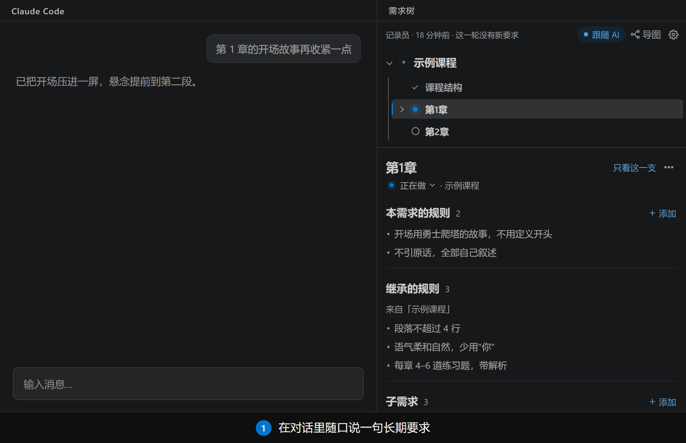
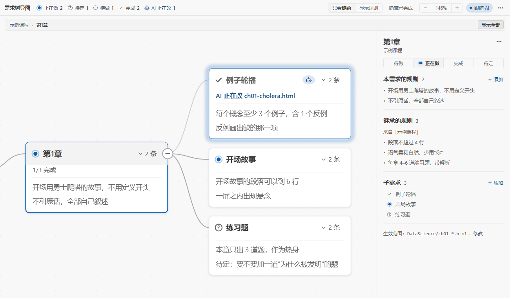
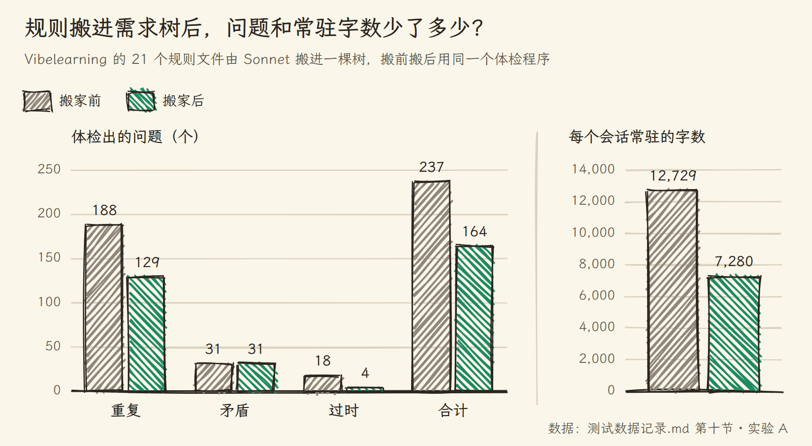
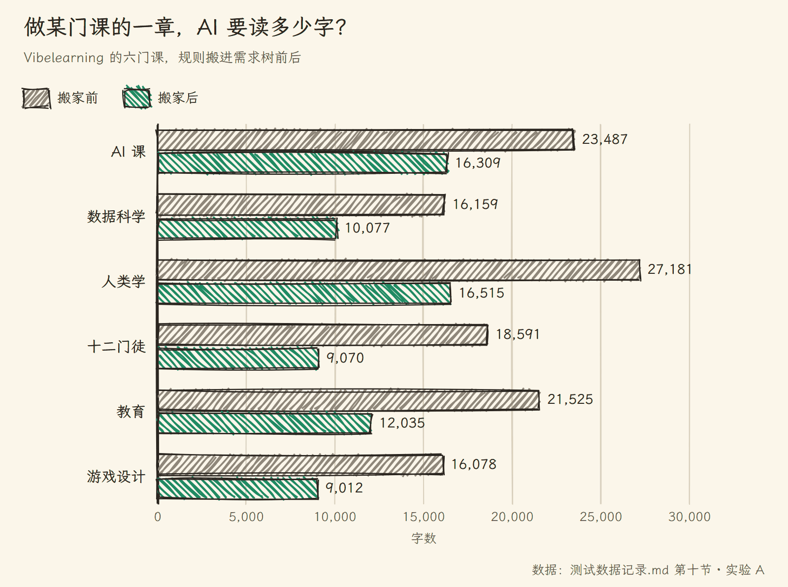
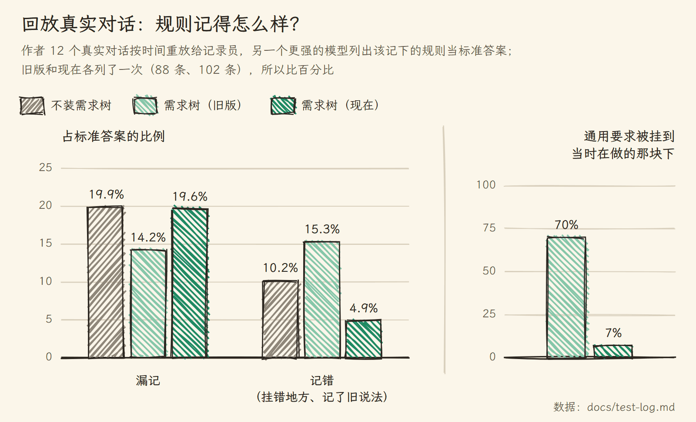

# Vibe Friend · 需求树 ReqTree

和 AI 一起做项目，"我们之前不是定好了吗"这句话，你大概已经说过很多遍了。需求树就是为这句话做的。它把你在聊天里定下的需求和规则收进一棵树：AI 改到哪个文件，就把那部分规则递给它；你随口说的长期要求，后台会帮你记下来，记错了点一下撤销。

给 [Claude Code](https://claude.com/claude-code) 和 [OpenAI Codex](https://developers.openai.com/codex) 用，带一个 VS Code 插件。[English](README.en.md) | **中文**



在对话里说一句"以后每章结尾都加一道思考题"，这一轮结束，它就出现在树上。记错了，点一下撤销。

## 你是不是也遇到过

和 AI 一起做一个长期项目，几周下来，同一条规则会长出好几个分身：聊天里说过一遍，CLAUDE.md 里写过一遍，AI 的记忆里存过一遍，项目文档里又抄了一遍。后来你改了主意，只改了其中一处，另外三处还在坚持旧说法。

需求也差不多。一个功能改了又改，三周前定的方案被推翻了两次，做到后来，你自己都说不清项目现在是什么样：哪些做完了，哪些还在做，哪条规则才是最新的。

AI 那边也不轻松。对话一长、上下文一压缩，早先定好的"段落不超过 4 行"就没了；派出去的子 agent 只拿到一半规则；你问它"我们之前怎么定的"，它从三份互相打架的文档里挑一份给你。


我给自己做了几个月的课程项目做过一次体检：21 份规则文档、8 万多字，查出 237 处重复、矛盾和过时。agent 并行数这件事，一份文档写"一次只开一个"，另一份写"可以两三章并行"；"三道检查"这一条，在不同文件里被抄了 15 遍。

## 它做什么

<table>
<tr>
<td width="50%" valign="top"><br><sub>麻烦</sub><br>需求改了又改，现在到底是什么样？<br><sub>需求树</sub><br>一棵树看全貌：做到哪一步、哪版规则在生效。谁改了什么都有记录，都能撤销</td>
<td width="50%" valign="top"><br><sub>麻烦</sub><br>规则散在四处，不知道该听哪份的<br><sub>需求树</sub><br>所有规则住在一个文件里，每条只有一个位置</td>
</tr>
<tr>
<td width="50%" valign="top"><br><sub>麻烦</sub><br>差不多的规则加了一遍又一遍<br><sub>需求树</sub><br>记录员改写原来那条，不另起一条；记错了一键撤销</td>
<td width="50%" valign="top"><br><sub>麻烦</sub><br>上下文一压缩，AI 就把规则忘了<br><sub>需求树</sub><br>规则交给 Claude Code 自己的机制，压缩以后、子 agent 里照样在</td>
</tr>
<tr>
<td width="50%" valign="top"><br><sub>麻烦</sub><br>所有规则一股脑塞进上下文<br><sub>需求树</sub><br>改到哪个文件，才带上那个需求的规则</td>
<td width="50%" valign="top"><br><sub>麻烦</sub><br>母规则和子规则打架<br><sub>需求树</sub><br>子需求写明覆盖，只在自己的范围里算数</td>
</tr>
<tr>
<td width="50%" valign="top"><br><sub>麻烦</sub><br>不知道 AI 正在忙哪个需求<br><sub>需求树</sub><br>侧栏和导图实时标出它在改哪儿</td>
<td width="50%" valign="top"><br><sub>麻烦</sub><br>不想手写 Markdown<br><sub>需求树</sub><br>加规则、改状态、撤销，都能在面板上点</td>
</tr>
</table>

## 界面

| 侧栏（深色主题） | 导图（浅色主题）：点一个需求，别的分支淡下去 |
|---|---|
|  |  |

| 聚焦：只看这一支 | 上下文用量：这个会话加载了哪些规则、各多少字 |
|---|---|
|  |  |

界面跟着 VS Code 的显示语言走，中文和英文都有。

## 怎么装

**需要**：Node.js 18 以上、VS Code，以及 Claude Code 或 OpenAI Codex。

### 让 AI 帮你装

在你的项目里开一个 Claude Code 或 Codex 会话，把下面这段话发给它：

```text
帮我在这个项目里装上需求树（https://github.com/penstic123-code/Vibe-Friend）：
1. 运行 npx github:penstic123-code/Vibe-Friend init .（如果你是 Codex，在末尾加 --tool codex）
2. 从 https://github.com/penstic123-code/Vibe-Friend/releases/latest 下载最新的 reqtree-*.vsix，放到项目文件夹外面，告诉我放在哪
3. 不要自己运行 code --install-extension，告诉我怎么在 VS Code 里从 VSIX 安装它
```

第一步跑完，项目里就有了 hook 和一份 `需求树.md` 模板。插件留给你自己点着装，因为在 VS Code 里用命令行装插件，会把正在跑的 AI 会话一起重启，它就没法把话说完了。装好以后，新开一个会话就能用。

### 自己装

1. 装 VS Code 插件：从 [Releases](https://github.com/penstic123-code/Vibe-Friend/releases) 下载 `reqtree-<版本>.vsix`，在扩展面板 → `…` → 「从 VSIX 安装」。
2. 打开你的项目，插件会问「在这个项目启用需求树？」，点「启用」。（也可以在命令面板运行「需求树：在本项目启用」。）
3. 新开一个 Claude Code 会话，照常干活。

不想装插件，只用命令行也行：

```bash
npx github:penstic123-code/Vibe-Friend init <你的项目目录>               # Claude Code
npx github:penstic123-code/Vibe-Friend init <你的项目目录> --tool codex # OpenAI Codex
```

启用会在项目里装好 hook（Claude Code 写进 `.claude/settings.local.json`，Codex 写进 `.codex/hooks.json` 和 `AGENTS.md` 的一个自动维护区块），没有 `需求树.md` 就建一个模板。hook 程序复制到你的用户目录 `~/.reqtree/runtime/`，插件升级后自动更新。Codex 的用法和差别见 [docs/codex.md](docs/codex.md)。

## 装好以后

平时你什么都不用多做：
- 你在对话里说"以后每章结尾都加一道思考题"，这一轮结束，它就出现在树上；
- AI 改 `ch01.html` 时，自动带上第 1 章和它上级的规则，别的课的规则不来凑热闹；
- 侧栏里看得到 AI 正在改哪个需求；记录员记错了，在「最近改动」里点撤销。

### 需求树长什么样

```markdown
# P 示例课程
- [段落] 段落不超过 4 行              ← 根节点的规则：全局生效

## C2 数据科学课 🔨
> 文件：DataScience/**                ← 这个需求对应哪些文件
> 文档：DataScience/_CHAPTERS.md      ← 参考资料：改这门课前提醒 AI 先读
- 不引原话，全部自己叙述

### C2.1 第1章 🔨
> 文件：DataScience/ch01-*.html
- [段落] 开场段落可以到 6 行          ← 同一个键：在第 1 章里覆盖母规则
- 一屏之内出现悬念
```

- 标题是需求：开头是编号，结尾是状态（✅ 完成 🔨 进行中 ⏳ 待做 ❓ 待定）
- 标题下的列表项是规则
- 没写 `> 文件：` 的需求沿用上级的范围；上级也没有，面板会提醒你
- `> 文档：` 挂参考资料，比如章节表、进度、架构说明、接口文档。文档不搬进规则，只在这个需求的规则里加一句「动手前先读某某（用途）」，用途取文档开头写的「用途：」那一行

## 原理

整套东西围着一个文件转。你和 AI 聊天，后台的记录员把长期要求写进 `需求树.md`；需求树被编译成一份份规则文件，每份写明自己管哪些文件；AI 改到那些文件时，Claude Code 自己会把规则交给它。


**按需加载。** 每个需求编译成 `.claude/rules/reqtree/<编号>.md`，头部用 `paths:` 写明它管哪些文件。这是 Claude Code 自带的路径规则：AI 读写匹配的文件时，规则才进入上下文。上级需求的范围包住下级，所以改第 1 章时，根节点、数据科学课、第 1 章三层规则一起到场，AI 课和门徒课的规则留在家里。


**记录员。** 每轮对话结束，一个 hook 在后台叫醒 Claude Haiku，把需求树和最近两轮对话（你的原话和 AI 的最后回复）交给它；每 8 轮和上下文压缩之前，还会把你最近说的话（最多 20 句）再给它过一遍，看有没有漏记。这些内容发给的是你本来就在用的模型服务（Claude Code 用 Anthropic，Codex 用 OpenAI 的 codex exec）。它先在树里找同一件事的规则：找到就改写，找不到才新增。"帮我把这段改短"这类一次性指令不记；"好""继续"这类短回复连模型都不叫。改动立即生效，每一条都记进 `.reqtree/changes.jsonl`，附带反操作，所以都能撤销。

**拿不准就问你。** 新说法和旧规则讲的是同一件事时，记录员以最新的为准改写旧规则，哪怕你没说"改成"。可有些事只有你能定。「第 5 章互动可以多一点」是这一章的例外，还是以后每章都这样？「手账风只用于第一篇」是收窄旧规则，还是另加一条？某一章到底算不算做完了？碰到这类情况，记录员先按最可能的意思记下，再在 VS Code 右下角弹一条通知，列出几种做法让你挑。不理它也没关系，先记下的那种一直有效；挑了别的，原来那条自动撤销，换成你挑的。标着进行中、好几天没动的需求，它也会来问一句做完没有。问题存在 `.reqtree/questions.jsonl`，七天没回答就按先记下的算。嫌它话多，可以在设置 `reqtree.askQuestions` 里改成只在侧栏图标上显示个数，或者干脆不问。

**体检。** 「需求树：体检」（侧栏和导图上的「体检」按钮，命令行是 `reqtree check --fix`）先问你这次查哪几样：需求树的规则、AI 的自动记忆、文档（需求挂的文档，加上项目根的 CLAUDE.md 和 AGENTS.md），默认全选，下次记住你的选择。规则这一样：同一个需求里几乎一样的规则合成一条，留后写的那条；找出上下级说法冲突、又没写成覆盖的规则，比如全局写每章互动不超过 4 个、某门课写不超过 5 个，每一处变成同样的选择题；指出到不了 AI 手上的规则（需求和上级都没设对应文件，或者对应的文件一个也找不到了）；规则多的需求，在面板上分组显示。文档这一样：文档里写成规则的地方，和树重复的提醒你从文档里删掉，和树打架的问你以哪边为准，树里还没有的问你要不要搬进树；挂了却找不到的文档、放在需求文件夹里却没挂上的文档，也会提醒。插件不改你的文档，只改需求树。记忆和文档加起来可能有十几万字，一次塞给模型会看不全，所以分批看，每批一次模型调用；太长的文件切成几段，每份都会被看到。上次体检后没改过的记忆和文档会跳过，第一次体检慢，以后很快；要全部重查，就勾上「全部重查」。要调用好几次模型时，会先告诉你这次要看几份、分几批。只有你运行它的时候才调用模型。

**规则、文档、记忆各管一块。** 同一条规则记在两处，迟早会一处改了、一处没改。所以三处分工：需求树记规则，也就是以后都要照着做的要求，包括某门课的做法、开几个 agent；文档记参考资料，比如章节表、进度、架构说明、某个决定的来由，用 `> 文档：` 挂在需求上；Claude Code 的自动记忆只记和项目内容无关的事，比如你这个人、你的工具和电脑环境、服务器和账号这类私人信息。需求树会提交进仓库，私人信息不该进去。CLAUDE.md 和 AGENTS.md 每次都全文加载，最好只留「东西在哪」这类几行说明，其余交给需求树按文件加载。AI 在某一轮把项目规则写进了记忆，记录员会把它收进树，再删掉那份记忆。AI 干活时自己发现的做法和坑（比如「这个脚本必须传绝对路径」），你没反对的，记录员也会记成规则，开头标「（AI 发现）」；不想要的话在齿轮菜单里关掉「也记下 AI 发现的做法」。体检时，已经写在树里或 CLAUDE.md 里的旧记忆会直接删掉；该进树的、和树说法打架的、已经过时的会一份份问你；像是某块内容的经验或进度的，提醒你挪进那块内容的文档。删之前都会先备份，所以都能撤销。不想要自动记忆，可以把设置 `reqtree.memoryMode` 改成 `treeOnly`。


**为什么不用 hook 往对话里塞规则。** 早期版本就是这么干的。后来发现 Claude Code 原生的规则机制更靠得住：子 agent 里、上下文压缩以后都照样生效，会话中途新建或修改的规则也会推给 AI。所以规则交给原生机制，hook 只做原生做不了的事：记下 AI 在改哪个需求、叫醒记录员。唯一的例外是动手之前的讨论：你问「第 3 章怎么设计」时 AI 还没打开任何文件，原生规则还没加载，hook 就把你点名的那个需求的规则补上，每个会话只补一次。

| 部件 | 做什么 |
|---|---|
| `src/parser.js` | 解析需求树；所有编辑都走 `applyOps`，每个操作返回反操作；相似度去重 |
| `src/compile.js` | 每个需求编译成一份原生规则；继承靠范围嵌套，覆盖写成"在本范围内以此为准" |
| `src/store.js` | 加锁原子写、写完自动编译、改动记录与撤销、状态文件 |
| `hooks/hook.js` | 发消息时确保规则最新；AI 改文件时记下属于哪个需求；一轮结束启动记录员 |
| `hooks/recorder.js` | 用 Haiku 判断这一轮有没有长期要求，改写或新增规则；拿不准的记成问题 |
| `src/questions.js`、`src/checkup.js` | 问题的存取、回答和撤销；久未动的需求；体检 |
| `extension.js`、`media/` | VS Code 侧栏和导图 |

## 省上下文、省 token

| 功能 | 状态 |
|---|---|
| 规则按需加载：AI 读或改到对应文件时，规则才进入上下文 | ✅ |
| hook 只在你点名某个需求、而 AI 还没碰它的文件时补一次规则，别的时候不往对话里加东西 | ✅ |
| 改写旧规则而不是新增，树不会越堆越长 | ✅ |
| 记录员用便宜的 Haiku，在后台跑；短回复不调用模型 | ✅ |
| 上下文用量表：每个会话加载了哪些规则、各多少字、哪些常驻哪些按需 | ✅ |
| 从 CLAUDE.md 拆分：把只属于某个需求的内容搬进树里按需加载 | 计划中 |
| 跨文件查重查矛盾：需求树和 CLAUDE.md、项目文档之间 | 计划中（已有实验脚本） |

实测下来，做一门课的一章，AI 要读的规则少了三到五成，见下面的「搬进需求树以后，会好多少」。

## 测试数据

下面每个实验回答一个问题。原始数据和实验条件都在 [`测试数据记录.md`](测试数据记录.md)。

### 记录员会不会记错、记重复？

记录员最常碰到六种情况：你换个说法重复一条旧规则；你改了主意；你提了一条新规则；你只是让 AI 改一处；你否决了一条规则；你在子需求里又说了一遍上级的规则。后来又加了两种容易混的：「第 1 章开头用霍乱的故事」是这一章以后都要守的决定，「把第 1 章那段压缩一下」改完就算完。用真实的 Haiku 把这些情况各跑 5 遍，记录员每次都做对了：重复的不加，改主意的改写原条，一次性的不记。


### 和让 AI 自己维护规则文档相比呢？

模拟一段 32 轮的对话：用户陆续提 13 条长期要求，中途改主意、取消、加例外。一组让 AI 自己维护一份规则文档，一组交给需求树。AI 自己记的时候，你说「思考题取消吧」，它常常再写一条「不设思考题」，旧的那条还留着；「第 2 章只出 3 道题」这种例外，有时被它写成了全局规则。需求树直接删掉被取消的那条，例外挂在第 2 章下面。最初需求树也会漏记某一章的内容决定，改了记录员的判断标准以后，13 条要求基本都记下了。


### 真实项目里的规则文档有多乱？

还是那个做了几个月的课程项目：21 份规则文档里，毛病集中在跨文件这一层。同一条规则抄在好几处，改了一处，别处还是旧的；有的地方写「一次只开一个 agent」，另一处写「可以两三章并行」。


### 搬进需求树以后，会好多少？

把这 21 份文档里的规则搬进一棵需求树，再用同一个体检程序查一遍。重复和过时少了一大截，因为同一条规则只剩一个位置，旧说法在搬家时就被新说法替掉了。矛盾没有变少：课程规则和全局规则冲突时，原文没写明「这门课例外」，搬家也没法替你决定该听谁的。这一步还得你来拍板，现在交给「拿不准就问你」。



省下的上下文更直观。原来每个会话都要带上 CLAUDE.md 和记忆，做某门课时还要整份读那门课的规则文档；搬进需求树以后，常驻的只剩全局规则，课程规则在改到那门课的文件时才加载。做任意一门课的一章，AI 要读的规则少了三到五成。



### 拿真实对话回放一遍呢？

把我过去几周 12 个会话里亲手打的 436 条消息按时间顺序回放：一组让 AI 像平时一样自己记进 CLAUDE.md、记忆和课程文档（每次只看得到其中几份），一组交给需求树。最后拿同一份标准答案对照。

需求树漏得少，被推翻的旧规则留得少，整个规则库只有另一组的三分之一大。它多出来的错误集中在一类：做某门课时顺口说的通用要求，比如「交流用中文」，被记到了那门课下面，做别的课时就带不上。记录员已经针对这一点改了判断标准。



## 目前的限制

- 支持 Claude Code 和 OpenAI Codex。Codex 没有按文件加载规则的机制，改用 `AGENTS.md` 里的索引加 hook 补送，见 [docs/codex.md](docs/codex.md)。
- 记录员靠小模型判断，偶尔会把规则挂错位置。它察觉到拿不准时会问你，没察觉的错要靠你在面板上改，或者在「最近改动」里撤销。
- 每轮对话多一次 Haiku 调用，在后台跑，约 6 秒。
- 在 Windows 上开发；Mac 和 Linux 由 CI 跑测试。

## 命令行

```bash
node bin/reqtree.js init    <项目目录>         # 启用：写入 hook、编译规则
node bin/reqtree.js tree    需求树.md          # 打印整棵树
node bin/reqtree.js rules   需求树.md C2.1     # 某个需求实际生效的规则
node bin/reqtree.js compile 需求树.md          # 手动编译（平时自动）
node bin/reqtree.js check   需求树.md          # 重复编号、重复规则、没有对应文件、很久没动的 🔨
node bin/reqtree.js check   需求树.md --fix    # 体检：规则、记忆、文档一起查（--no-model 不调用模型，--no-memory 不查记忆，--full 全部重查）
node bin/reqtree.js questions 需求树.md        # 等你回答的问题
node bin/reqtree.js answer  需求树.md <问题ID> <选项序号|dismiss>
```

**注意**：不要在用着 Claude Code 的时候用命令行强制重装插件（`code --install-extension --force`），那会重启 VS Code 的插件宿主，Claude Code 跟着重启。

## 开发

```bash
node --test test/*.test.js        # 全部自动测试（界面测试需要 Edge 或 Chrome）
node test/eval-recorder.js 3      # 用真实 Haiku 评测记录员（花少量额度）
node test/eval-confusion.js 2     # 装与不装的对照实验（约 200 次调用）
```

## 许可

MIT
