# Vibe Friend · 需求树 ReqTree

**一棵需求树，让你和 AI 都看清这个项目。**

散在聊天里的需求和规则，整理成一棵看得见的树：项目现在是什么样、每个需求做到哪一步，一眼就知道；AI 改到哪个文件，只带上那里的规则；你说过的长期要求自动记下来，记错了能撤销。

给 [Claude Code](https://claude.com/claude-code) 和 [OpenAI Codex](https://developers.openai.com/codex) 用，带一个 VS Code 插件。[English](README.en.md) | **中文**

> 🚧 代码正在做最后的整理和测试，很快上传到这个仓库。现在你看到的是介绍和测试数据。

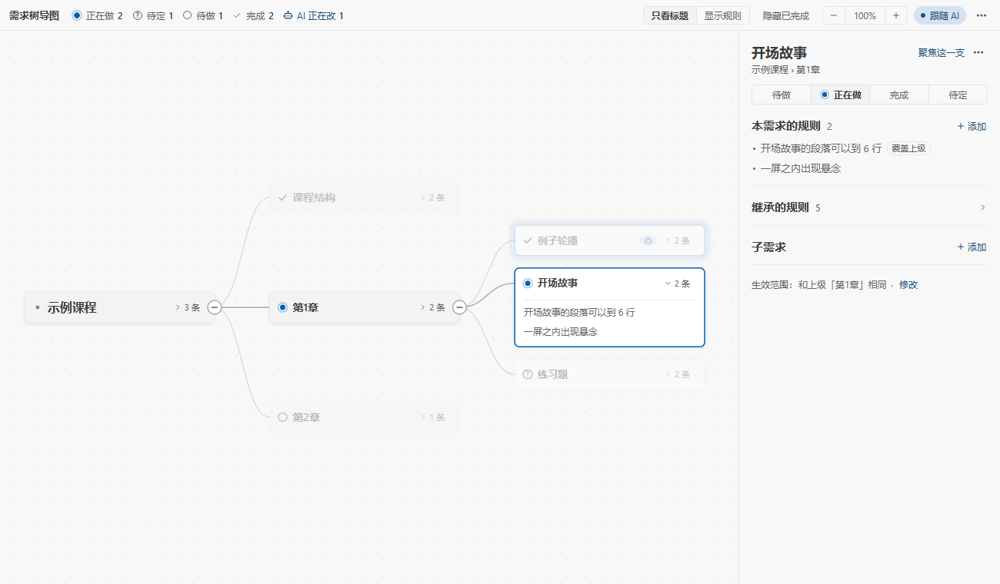

## 你是不是也遇到过

和 AI 一起做一个长期项目，几周下来，规则散得到处都是：聊天记录里说过一遍，CLAUDE.md 里写过一遍，AI 的记忆里存过一遍，项目文档里又抄了一遍。后来你改了主意，只改了其中一处，剩下几处还是旧说法。

需求也一样。一个功能改了又改，三周前定的方案被推翻两次，做到后来，连你自己都说不清项目现在是什么样：哪些需求做完了，哪些还在做，哪条规则是最新的说法。

对话一长，AI 开始忘事。上下文被压缩以后，早先定好的"段落不超过 4 行"不见了；派出去的子 agent 只拿到一部分规则；你问它"我们之前怎么定的"，它从三份互相矛盾的文档里挑一份。

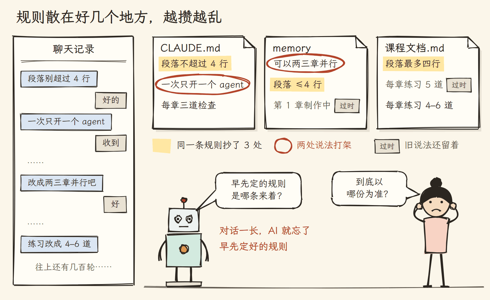

作者体检了自己做了几个月的课程项目：21 份规则文档、8 万多字里，有 **237 处重复、矛盾和过时**。比如 agent 并行数，一份文档写"一次只开一个"，另一份写"可以两三章并行"；同一条"三道检查"在不同文件里抄了 15 遍。

## 它有什么用

<table>
<tr>
<td width="50%" valign="top">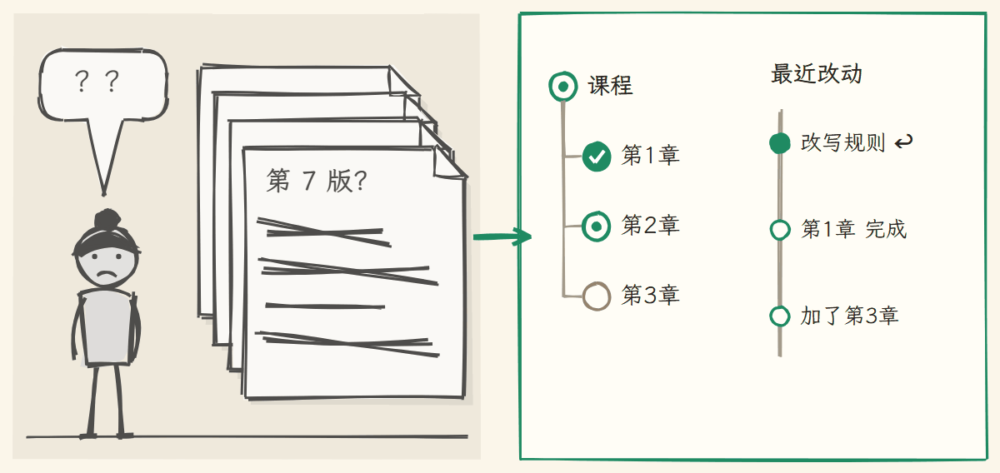<br><sub>麻烦</sub><br>需求改了又改，现在到底是什么样？<br><sub>需求树</sub><br><b>一棵树看全貌：做到哪一步、哪版规则在生效；每次改动都有记录，能撤销</b></td>
<td width="50%" valign="top">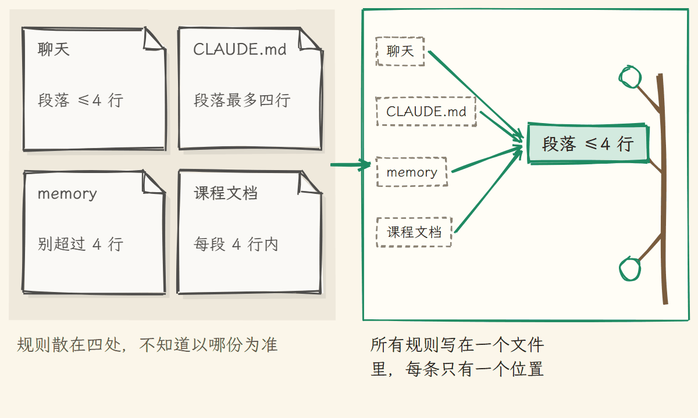<br><sub>麻烦</sub><br>规则散在四处，不知道以哪份为准<br><sub>需求树</sub><br><b>所有规则写在一个文件里，每条只有一个位置</b></td>
</tr>
<tr>
<td width="50%" valign="top">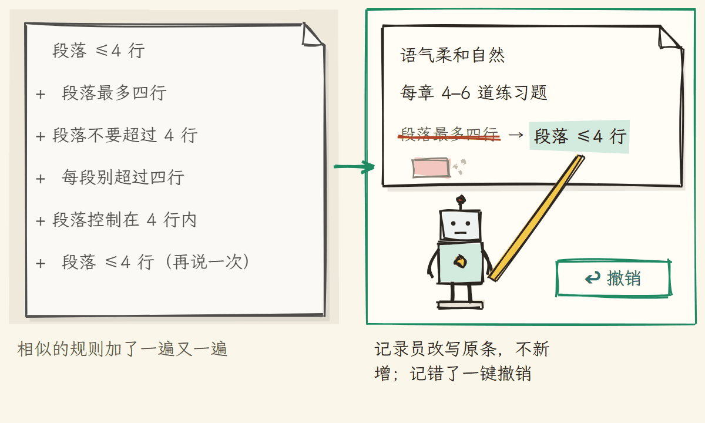<br><sub>麻烦</sub><br>相似的规则加了一遍又一遍<br><sub>需求树</sub><br><b>记录员改写原条，不新增；记错了一键撤销</b></td>
<td width="50%" valign="top">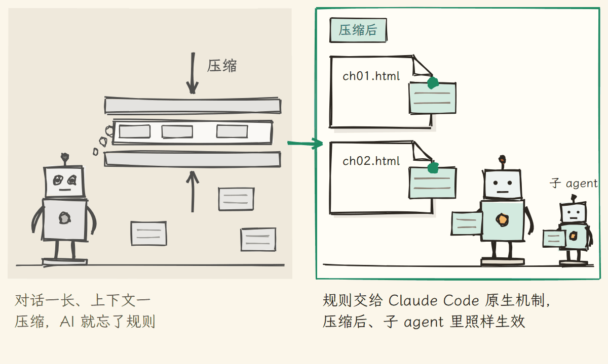<br><sub>麻烦</sub><br>对话一长、上下文一压缩，AI 就忘了规则<br><sub>需求树</sub><br><b>规则交给 Claude Code 原生机制，压缩后、子 agent 里照样生效</b></td>
</tr>
<tr>
<td width="50%" valign="top">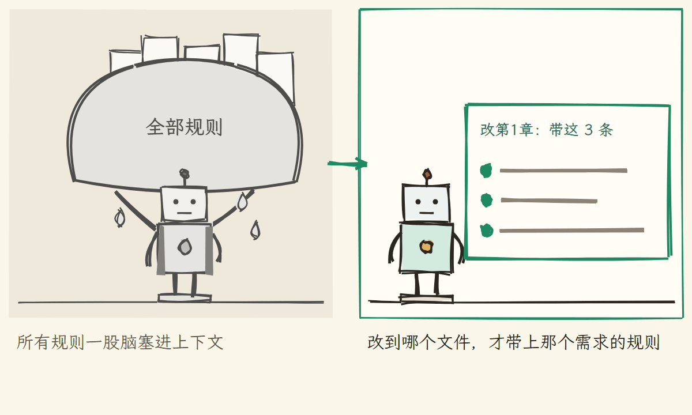<br><sub>麻烦</sub><br>所有规则一股脑塞进上下文<br><sub>需求树</sub><br><b>改到哪个文件，才带上那个需求的规则</b></td>
<td width="50%" valign="top">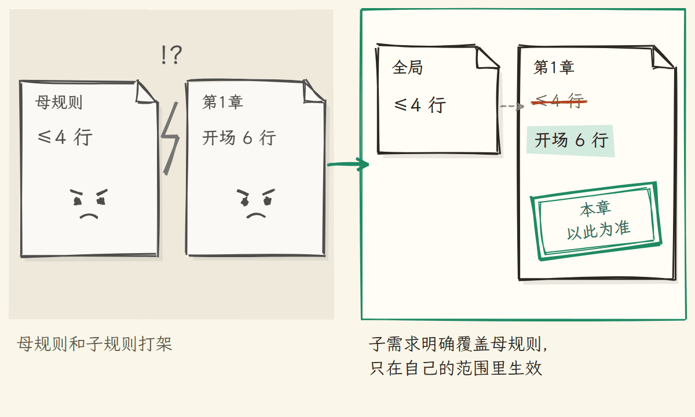<br><sub>麻烦</sub><br>母规则和子规则打架<br><sub>需求树</sub><br><b>子需求明确覆盖母规则，只在自己的范围里生效</b></td>
</tr>
<tr>
<td width="50%" valign="top">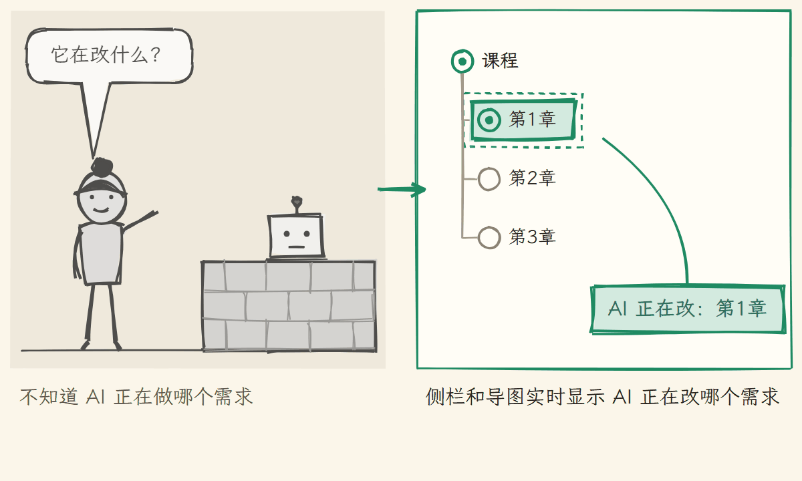<br><sub>麻烦</sub><br>不知道 AI 正在做哪个需求<br><sub>需求树</sub><br><b>侧栏和导图实时显示 AI 正在改哪个需求</b></td>
<td width="50%" valign="top">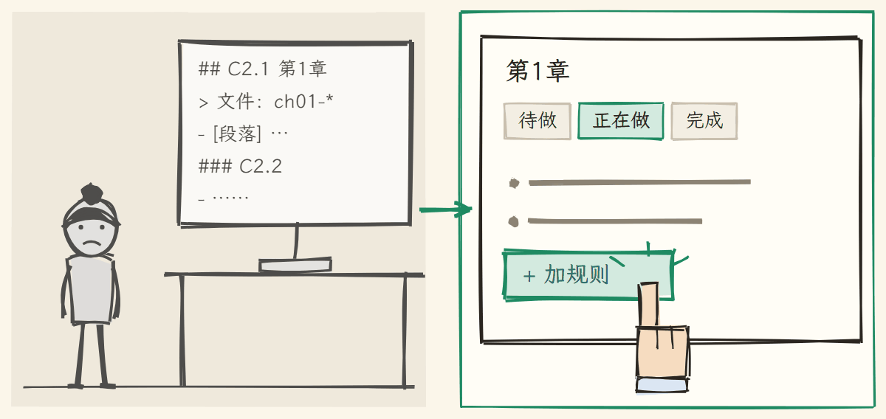<br><sub>麻烦</sub><br>不想手写 Markdown<br><sub>需求树</sub><br><b>加规则、改状态、撤销，全部能在面板上点</b></td>
</tr>
</table>

## 看一眼

| 侧栏（深色主题） | 导图（浅色主题） |
|---|---|
| 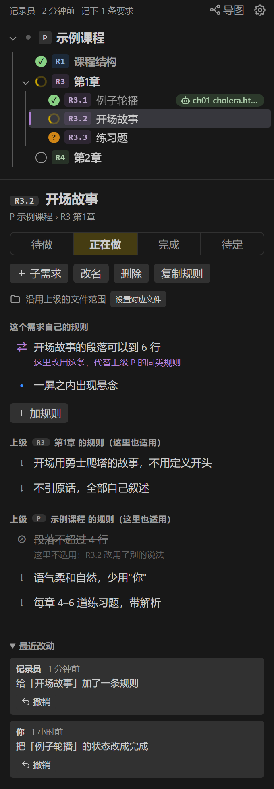 |  |

## 怎么用

**需要**：Node.js 18 以上、VS Code，以及 Claude Code 或 OpenAI Codex。

1. 装 VS Code 插件：从 [Releases](https://github.com/penstic123-code/Vibe-Friend/releases) 下载 `reqtree-<版本>.vsix`，在扩展面板 → `…` → 「从 VSIX 安装」。
2. 打开你的项目，插件会问「在这个项目启用需求树？」，点「启用」。（也可以在命令面板运行「需求树：在本项目启用」。）
3. 新开一个 Claude Code 会话，照常工作。

不用插件、只用命令行也可以：

```bash
npx github:penstic123-code/Vibe-Friend init <你的项目目录>               # Claude Code
npx github:penstic123-code/Vibe-Friend init <你的项目目录> --tool codex # OpenAI Codex
```

启用会在项目里装好 hook（Claude Code 写进 `.claude/settings.local.json`，Codex 写进 `.codex/hooks.json` 和 `AGENTS.md` 的一个自动维护区块），没有 `需求树.md` 就建一个模板。hook 程序复制到你的用户目录 `~/.reqtree/runtime/`，插件升级后自动更新。Codex 的用法和差别见 [docs/codex.md](docs/codex.md)。

平时你什么都不用多做：
- 你在对话里说"以后每章结尾都加一道思考题"，这一轮结束后它会出现在树上；
- AI 改 `ch01.html` 时，自动带上第 1 章和它上级的规则；
- 侧栏里看得到 AI 正在改哪个需求；记录员记错了，在「最近改动」里点撤销。

### 需求树长什么样

```markdown
# P 示例课程
- [段落] 段落不超过 4 行              ← 根节点的规则：全局生效

## C2 数据科学课 🔨
> 文件：DataScience/**                ← 这个需求对应哪些文件
- 不引原话，全部自己叙述

### C2.1 第1章 🔨
> 文件：DataScience/ch01-*.html
- [段落] 开场段落可以到 6 行          ← 同一个键：在第 1 章里覆盖母规则
- 一屏之内出现悬念
```

- 标题是需求：开头是编号，结尾是状态（✅ 完成 🔨 正在做 ⏳ 待做 ❓ 待定）
- 标题下的列表项是规则
- 没写 `> 文件：` 的需求沿用上级的范围；上级也没有，面板会提醒你

## 原理

整套东西围着一个文件转。你和 AI 对话，后台的记录员把长期要求写进 `需求树.md`；需求树被编译成一份份规则文件，每份写明自己管哪些文件；Claude Code 原生的机制负责在 AI 改到那些文件时把规则交给它。

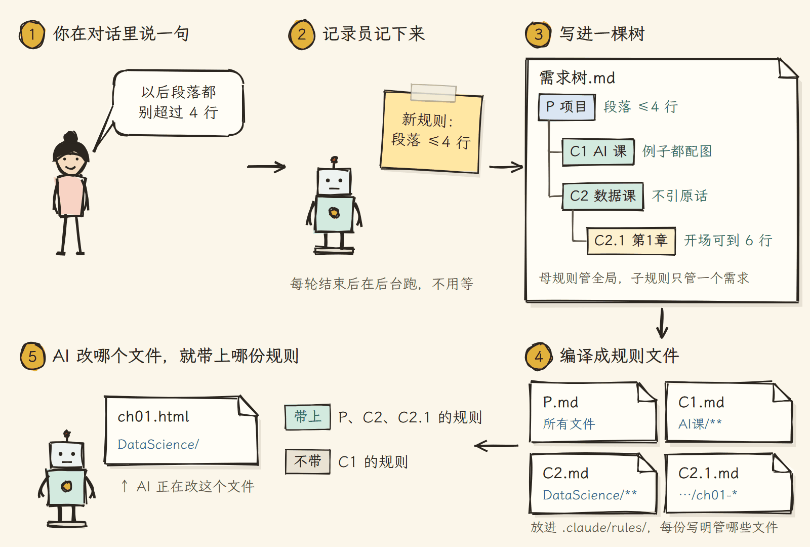

**按需加载。** 每个需求编译成 `.claude/rules/reqtree/<编号>.md`，头部用 `paths:` 写明它管哪些文件。这是 Claude Code 自带的路径规则：AI 读写匹配的文件时，规则才进入上下文。上级需求的范围包住下级，所以改第 1 章时，根节点、数据科学课、第 1 章三层规则一起到场，AI 课和门徒课的规则不来。

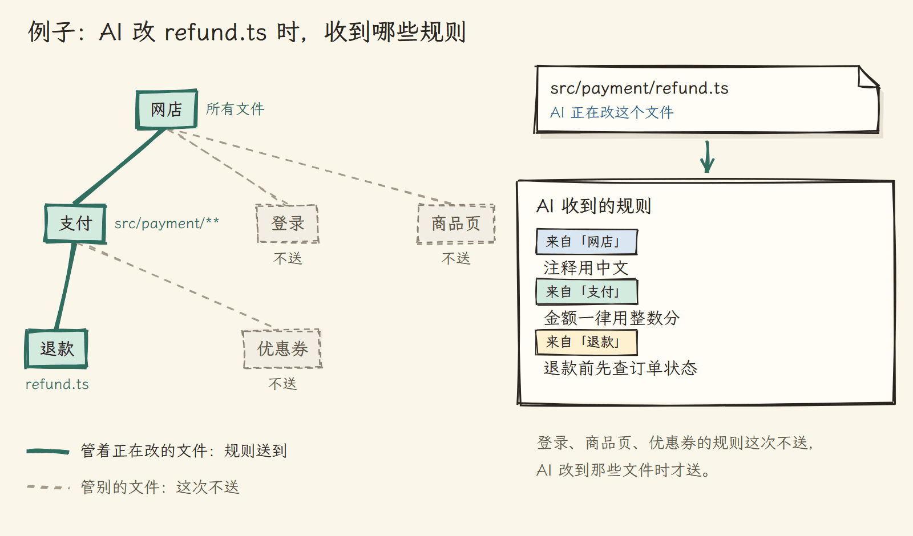

**记录员。** 每轮对话结束，一个 hook 在后台启动 Claude Haiku，只读你这一轮的原话和 AI 的最后回复。它先在树里找同主题的规则：找到就改写，没找到才新增；"帮我把这段改短"这类一次性指令不记，"好""继续"这类短回复直接跳过，不调用模型。改动立即生效，每一条都记进 `.reqtree/changes.jsonl` 并附带反操作，所以都能撤销。

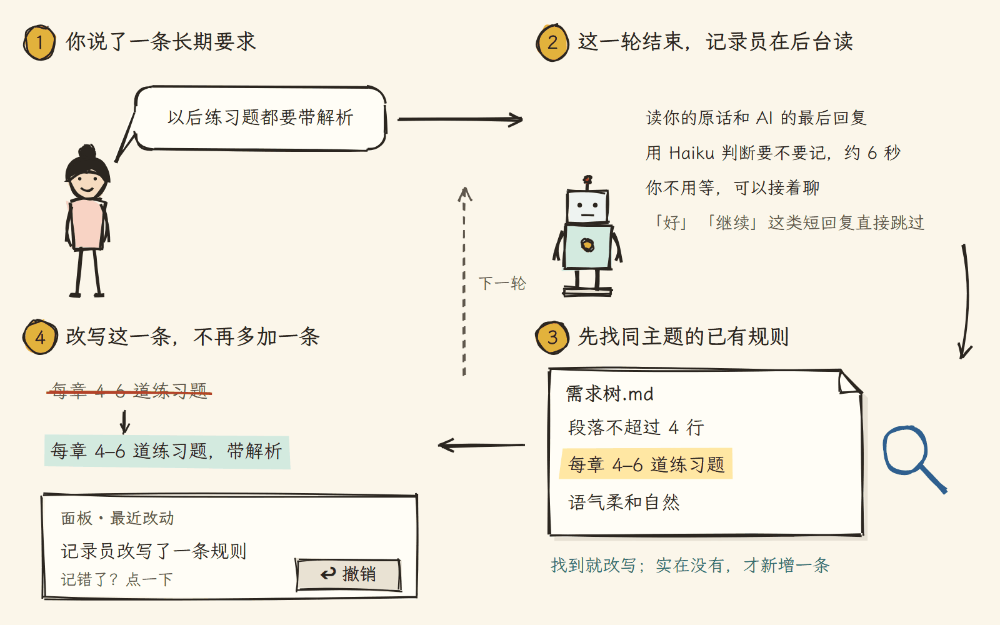

**为什么不用 hook 往对话里塞规则。** 早期版本就是这么做的。后来发现 Claude Code 原生的规则机制更可靠：子 agent 里、上下文压缩以后都照样生效，会话中途新建或修改规则也会推给 AI。所以 hook 现在只做原生没有的事：记下 AI 在改哪个需求、启动记录员，不往 AI 的上下文里加一个字。

| 部件 | 做什么 |
|---|---|
| `src/parser.js` | 解析需求树；所有编辑都走 `applyOps`，每个操作返回反操作；相似度去重 |
| `src/compile.js` | 每个需求编译成一份原生规则；继承靠范围嵌套，覆盖写成"在本范围内以此为准" |
| `src/store.js` | 加锁原子写、写完自动编译、改动记录与撤销、状态文件 |
| `hooks/hook.js` | 发消息时确保规则最新；AI 改文件时记下属于哪个需求；一轮结束启动记录员 |
| `hooks/recorder.js` | 用 Haiku 判断这一轮有没有长期要求，改写或新增规则 |
| `extension.js`、`media/` | VS Code 侧栏和导图 |

## 省上下文、省 token

| 功能 | 状态 |
|---|---|
| 规则按需加载：只在改到对应文件时进入上下文 | ✅ |
| hook 不往对话里加内容 | ✅ |
| 改写旧规则而不是新增，树不会越堆越长 | ✅ |
| 记录员用便宜的 Haiku，在后台跑；短回复不调用模型 | ✅ |
| 上下文用量表：每个会话加载了哪些规则、各多少字、哪些常驻哪些按需 | 记录已完成，面板显示开发中 |
| 从 CLAUDE.md 拆分：把只属于某个需求的内容搬进树里按需加载 | 计划中 |
| 跨文件查重查矛盾：需求树和 CLAUDE.md、项目文档之间 | 计划中（已有实验脚本） |

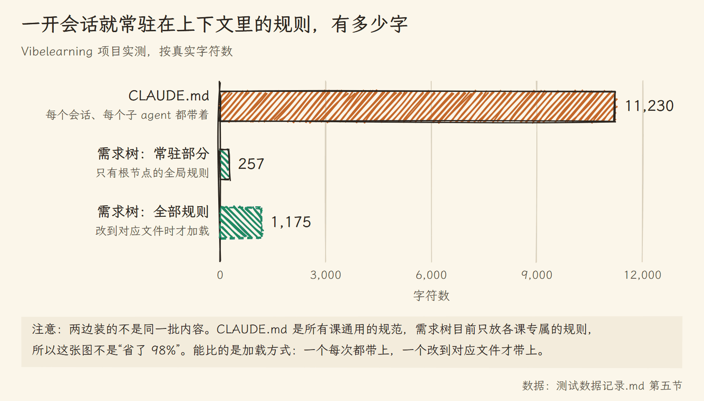

## 测试数据

原始数据和实验条件都在 [`测试数据记录.md`](测试数据记录.md)。

**记录员判断得准不准。** 6 类情况各跑 3 遍，用真实的 Haiku：换说法重复的不加、改主意的改写原条、真正的新规则才加、一次性指令不记、否决的删掉、子需求重复上级的不加。18 次全对。

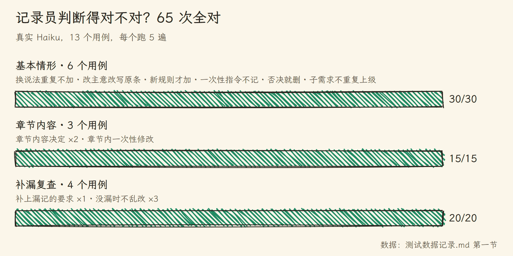

**装与不装，规则会不会更乱。** 模拟 32 轮对话，用户陆续提 13 条长期要求，中途改主意、取消、加例外。三组对比：AI 自己维护规则文档（普通提示词、认真提示词）和需求树的记录员。AI 自己记时，取消的规则会变成一条新的"不要……"留在文档里，有的规则挂到了错误的范围；需求树没有这两种问题。三组都有漏记。

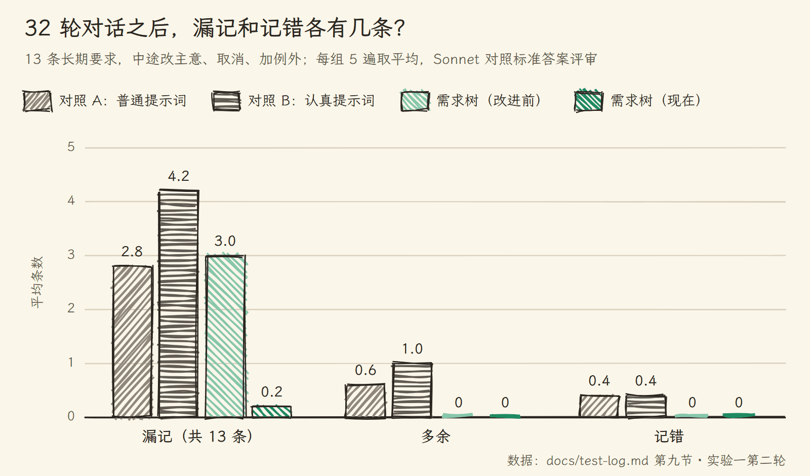

**真实项目里有多乱。** 体检一个真实课程项目的 21 份规则文档，问题集中在**跨文件**这一层：同一条规则抄在好几处，改了一处，别处还是旧的。需求树让每条规则只有一个位置，从根上避开这类问题。

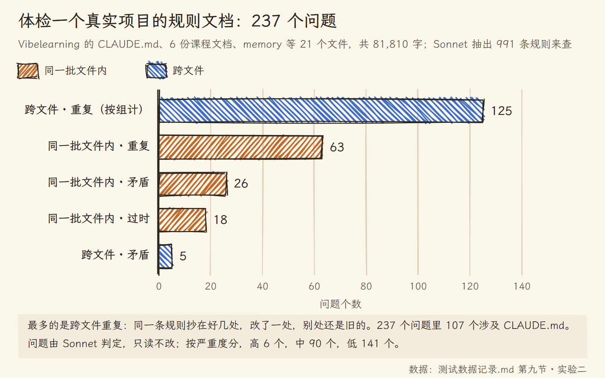

## 目前的限制

- 支持 Claude Code 和 OpenAI Codex。Codex 没有按文件加载规则的机制，改用 `AGENTS.md` 里的索引加 hook 补送，见 [docs/codex.md](docs/codex.md)。
- 记录员会漏记，尤其是"第 1 章开头用某个故事"这类只关于一章的内容决定。漏了可以在面板上手动加。
- 每轮对话多一次 Haiku 调用，在后台跑，约 6 秒。
- 在 Windows 上开发；Mac 和 Linux 由 CI 跑测试。

## 命令行

```bash
node bin/reqtree.js init    <项目目录>         # 启用：写入 hook、编译规则
node bin/reqtree.js tree    需求树.md          # 打印整棵树
node bin/reqtree.js rules   需求树.md C2.1     # 某个需求实际生效的规则
node bin/reqtree.js compile 需求树.md          # 手动编译（平时自动）
node bin/reqtree.js check   需求树.md          # 重复编号、没有对应文件、很久没动的 🔨
```

**注意**：不要在用着 Claude Code 的时候用命令行强制重装插件（`code --install-extension --force`），那会重启 VS Code 的插件宿主，Claude Code 跟着重启。

## 开发

```bash
node --test test/*.test.js        # 全部自动测试（界面测试需要 Edge 或 Chrome）
node test/eval-recorder.js 3      # 用真实 Haiku 评测记录员（花少量额度）
node test/eval-confusion.js 2     # 装与不装的对照实验（约 200 次调用）
```

## 许可

MIT
